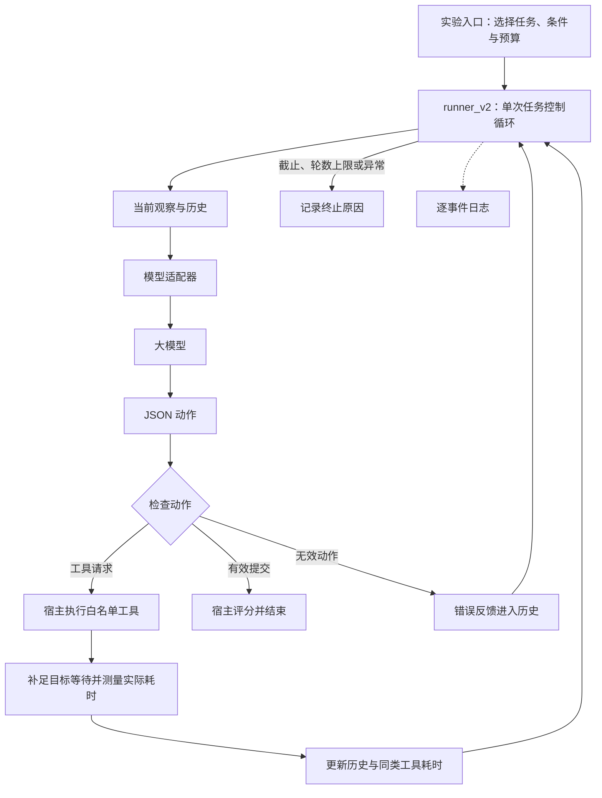

# 实验 Agent 构造说明

更新日期：2026-11-01。当前执行链路为 `scripts/go_study.py → src/runner_v2.py → OpenCodeGo`。连续钟与精确证据提示修订后，诊断 18/18 全部正确，新完整开发 216/216、166 正确并通过全部准入；正式1080次和独立144次探针均已完成。主比较收益尚不确定，详见[最终报告](实验最终报告_20261101.md)。采样后仅修复内部报告结构计数与终态措辞，冻结采样快照和原记录不变。旧 CLI 候选及各修复前数据保留作历史，不并入正式结果。实际阶段和修订见[执行记录](执行记录_20261030.md)。

配套阅读：[后续实验计划](后续实验计划_20261030.md)、[历史实验执行方案](../Agent工具延迟变化与时间预算适应_实验执行方案.md)。

## 1. 这个 Agent 是什么

这是一个面向实验的单模型、串行工具调用 Agent。模型决定下一步做什么，Python 控制程序执行工具、返回观察、管理截止和记录轨迹。

Agent 可以理解为“模型决策 + 工具 + 当前任务状态 + 反复执行的控制循环”。这里的 Python agent 不是某个现成产品名称；核心程序也没有训练模型。模型通过已有能力选择查询、读取、计算或提交，实验框架研究不同时间信息如何影响这些选择。

一次从接收题目到提交、超时或异常终止的完整执行称为一个 episode。一次批次包含多个 episode。

| 部分 | 职责 | 不应承担的职责 |
|---|---|---|
| 模型 | 理解题目，选择工具与参数，整理证据，决定是否提交 | 访问私有答案，获知未来延迟或隐藏变化点 |
| 控制循环 | 构造观察，检查动作，执行工具，控制时间与终止 | 替模型写死解题步骤，提前把正确动作告诉模型 |
| 任务环境 | 保存公开资料，提供工具查询，施加延迟 | 给模型返回评分答案或未来环境状态 |
| 评分器 | 对提交做数值与证据检查 | 在首次有效提交后反馈分数让模型重试 |
| 批次管理 | 编排配对运行，保存配置、哈希和记录 | 静默删除失败，覆盖历史结果 |

## 2. 整体结构和调用链



Go 入口根据诊断、开发或正式阶段选择任务，预校准工具、建立配对清单，再由 worker 调用 runner。工具函数只闭包绑定 `task['public']`，评分函数绑定 `task['private']`。旧 CLI 的接口分工不能单独证明文件隔离；Go 适配器只发送显式观察和历史，不向远程模型提供宿主执行工具。

## 3. 代码模块如何分工

| 文件 | 在系统中的作用 |
|---|---|
| [go_study.py](../scripts/go_study.py) | 当前 Go 实验入口，三模型批次、冻结快照、配对块与并发 worker |
| [opencode_go.py](../src/adapters/opencode_go.py) | 当前 HTTP 模型适配器：原生 API、JSON 动作、取消、会话和用量 |
| [go_gates.py](../scripts/go_gates.py) | 验证离线、诊断、开发和公开答案复核证据，控制正式准入 |
| [run_v5_pilot.py](../scripts/run_v5_pilot.py) | 最新小规模开发入口，准备任务、模型、校准、清单及结果目录 |
| [runner_v2.py](../src/runner_v2.py) | 单个 episode 的观察—决策—执行循环、截止、重试与终止 |
| [conditions.py](../src/conditions.py) | A/B/C 的耗时参考计算，以及三种环境的延迟阶段选择 |
| [calibration.py](../src/calibration.py) | 在 episode 外用合成公开输入测量初始工具耗时 |
| [codex_mxc_v2.py](../src/adapters/codex_mxc_v2.py) | 历史 CLI 适配器：每轮启动 Codex，取得 JSON 动作 |
| [codex_events_v2.py](../src/adapters/codex_events_v2.py) | 检查 CLI 事件和错误，记录动作消息与终止事件时刻 |
| [data_v4.py](../tasks/data_v4.py) | 当前候选任务版本：摘要检索扩展，继承 v3 分页与 v2 数据 |
| [data_v3.py](../tasks/data_v3.py) | 两行一页的表格查询协议 |
| [data_v2.py](../tasks/data_v2.py) | 随机化 ID、行顺序及证据任务结构，复用底层工具和评分 |
| [data.py](../tasks/data.py) | 基础生成、数值计算、工具与确定性评分 |
| [matrix.py](../scripts/matrix.py) | 配对清单、配置哈希、不覆盖式写入、journal 与恢复底层接口 |
| [analyze_matrix.py](../scripts/analyze_matrix.py) | 配对统计及按任务实例聚类的 bootstrap |

版本号不属于同一个维度：v5 是开发批次入口名称，使用的是 v4 任务和 v2 runner/适配器；不存在一个已经实现并获验证的“统一 v5 正式系统”。

## 4. 控制循环的接口

核心函数可以概括为：

```python
await run_episode(
    model=model,
    question=公开题面,
    tool_schemas=本题允许的工具说明,
    calibration=初始耗时样本,
    call_tool=公开工具执行函数,
    verify=私有评分函数,
    condition="C",
    profile="fast_to_slow",
    budget_s=180,
)
```

`model` 需要提供异步接口 `decide(observation, history)`。runner 不需要知道底层通过 CLI、HTTP 还是其他方式调用模型。这是后续替换为 API 适配器的主要接缝。

控制逻辑如下，属于解释性伪代码：

```python
初始化截止时间、历史、事件和工具耗时列表
for step in range(max_steps):
    检查截止
    observation = 构造当前公开观察和时间参考
    action = 在剩余预算内等待 model.decide(observation, history)
    if action 是格式有效提交:
        调用私有评分器
        结束
    elif action 是允许的工具调用:
        执行工具，并按环境目标耗时补足等待
        将完整结果和实际耗时加入历史
    else:
        将动作错误加入历史
达到上限或发生异常时记录对应终止原因
```

模型可以选择工具顺序、查询条件和提交时机；程序没有预置每道题的解题计划。当前没有独立 planner、任务分解器、多个协作 agent 或显式计划对象。

## 5. 模型每轮能看到什么

`observation` 包含当前题目、工具说明、初始校准样本、总预算/已用/剩余时间。B/C 另外包含 `duration_reference_s`，说明它只是历史参考，不保证未来耗时。

下面是解释结构的示意数据，不是实测轨迹：

```json
{
  "question": "计算符合条件的批次总货款，并提交证据行 ID。",
  "tools": {"lookup_rows": {"description": "按条件查询，分页返回"}},
  "calibration_samples_s": {"lookup_rows": [2.01, 2.00, 2.02]},
  "time_status": {"budget_s": 180, "elapsed_s": 70, "remaining_s": 110},
  "duration_reference_s": {"lookup_rows": 6.34}
}
```

题目数据库本身不会整包放入观察；模型通过工具逐步获取材料。模型也不应收到 private、延迟模式名、变化点或未来工具耗时。

时间在每次请求前采样。模型生成期间，提示中的剩余时间自然会变旧；系统没有逐 token 更新时钟。应区分“给出时间反馈”和“模型持续获得实时钟表”。

## 6. 动作协议与工具执行

模型每轮输出一个 JSON 对象。工具动作例子：

```json
{"type":"tool","name":"lookup_rows","arguments":{"table":"batches","filters":{"status":"active"}}}
```

提交动作例子（数值与 ID 仅为格式示意）：

```json
{"type":"submit","answer":{"value":400,"evidence_ids":["P-A","B-C"]}}
```

当前这是提示中的文本 JSON 协议。`tool_schemas` 是项目工具说明字典，不等于供应商原生 function calling 的严格 JSON Schema。适配器解析输出，runner 检查动作类型、工具白名单和参数对象，具体工具再校验查询字段。

| 任务族 | 工具 | 当前行为 |
|---|---|---|
| 证据 | `search` | v4 仅按无答案摘要匹配，最多五条；可查询“档案”浏览摘要 |
| 证据 | `read_document` | 按文档 ID 返回全文 |
| 表格 | `lookup_rows` | 查询 products/batches，按字段相等筛选，每页最多两行 |
| 表格 | `calculate` | 计算受限数值表达式 |

分页返回 `next_cursor`；后续页要求保持相同表和过滤条件。选择先筛选还是读全部页，是模型可以改变的行为。工具没有直接提供“解决整个任务”的函数，否则难以观察信息获取策略。

单个 episode 每轮最多执行一个工具，工具之间串行；新开发配置在 episode 之间每模型并发 2、全局最多 6，不能把它说成单个 agent 会并行调用工具。同一 A/B/C 配对块分给同一 worker 按清单顺序执行，两个 worker 处理不同块。

## 7. 时间预算和环境变化

当前 runner 使用 [elapsed_clock.py](../src/elapsed_clock.py) 建立包含系统休眠的单调截止：Mac 使用 `CLOCK_MONOTONIC_RAW`，Linux 使用 `CLOCK_BOOTTIME`；不能跨平台照搬同名常量。不支持的宿主在开始前拒绝运行。旧版本的 `time.monotonic()` 在这台 Mac 使用不计休眠的 `mach_absolute_time()`，因此旧批次不能作为修复后协议的数据。

`EpisodeClock.wait()` 每至多 0.25 秒检查连续钟，任务完成时也复核实际完成时刻；超过截止的动作不会执行。连续钟与不计休眠的单调钟累计差超过 1 秒则记录 `environment_interruption`、取消当前等待、停止扩量；不算模型能力失败，也不进入工具耗时样本。模型请求、重试和工具等待共用同一截止，不重置预算。提交按模型响应到达时刻判断；到达后的日志写入变慢不倒改其是否及时。结果另记结束 UTC、连续钟名称与休眠差值，不记录绝对开机时长。

Mac 新批次通过进程范围的 `caffeinate -i` 阻止自动休眠，进程退出后解除，不修改永久系统设置。手动强制休眠仍可能发生，由上述监测拒收受影响样本。[Apple 连续钟说明](https://developer.apple.com/documentation/driverkit/mach_continuous_time)、[Linux 时钟说明](https://man7.org/linux/man-pages/man2/clock_gettime.2.html)。

最新 v5 的候选设置为 180 秒预算，变化比例 0.2，即 36 秒；快/慢工具目标耗时为 2/15 秒。默认函数参数仍为 120 秒和 0.5，不能把默认参数与 v5 的实际配置混淆。

Go 基础诊断使用 300 秒、stable_fast、A。首轮开发为 180 秒、12 秒变化点；完整开发出现主环境天花板后，按预登记规则将共同预算减至 150 秒、变化点仍为 12 秒。连续钟修复后的新候选保留 150/12 秒，不依据 C−B 选择参数。各批次实际参数读取冻结配置，不能跨批次套用。

| 延迟模式 | 起始阶段 | 变化后 |
|---|---|---|
| `stable_fast` | 快 | 快 |
| `fast_to_slow` | 快 | 慢 |
| `slow_to_fast` | 慢 | 快 |

阶段由工具开始时刻决定。第 35 秒开始的调用按快阶段处理，即使完成时已跨过第 36 秒。所有有效工具当前共用同一快/慢目标；不应把工具间差异解释成已实现的独立延迟过程。

先做本地计算，再等待 `max(0, 目标耗时 − 已用计算时间)`。目标 15 秒不是额外固定增加 15 秒。最终记录实际耗时，可能略高于目标。

本地工具调用是同步函数；若未来换成长耗时同步操作，现有异步超时无法在它阻塞事件循环时即时抢占，必须重新设计执行方式。超时清理也可能使最终日志时间稍晚于预算，不能据此认定截止后的答案有效。

## 8. A/B/C：共同信息与真正的自变量

三组都看到初始校准样本、历史完整工具耗时和剩余时间。A 也可以自行估时。因此研究问题是“额外提供固定或动态摘要是否有帮助”，不能写成“有时间意识对比没有时间意识”。

| 条件 | 额外参考 |
|---|---|
| A | 不额外给均值 |
| B | 初始校准均值，整个 episode 固定 |
| C | 当前 episode 最近最多三次已完成同类工具耗时的均值；没有样本则回退到初始均值 |

若当前 episode 最近三次同类工具耗时为 `[2, 2, 15]`，C 给 6.33 秒；继续出现 15 秒后，窗口均值逐步变成 10.67、15 秒。这说明移动均值有滞后，不是未来耗时的预言。

C 一旦有第一条新样本，就使用 episode 中的新样本；初始校准不作为三个虚拟旧调用与之混合。不同工具独立统计，无效、取消和删失调用不进入完整耗时列表。

校准在 episode 外用合成公开输入测量，每工具至少三条；当前实现并发采样，这些测量不能宣称统计独立。新实验应冻结实际采样方法。

## 9. 状态与记忆

| 状态 | 内容 | 用途 |
|---|---|---|
| `history` | 工具动作、返回结果、实际耗时、无效动作反馈 | 作为下一轮模型输入 |
| `completed` | 各工具的已完成耗时列表 | 生成 C 的滚动参考 |
| `events` | 模型请求、时间快照、动作、工具和异常记录 | 离线统计与审计 |
| `result` | 最终答案、评分、终止原因等 | episode 汇总 |

每轮把当前观察和完整可见历史重新序列化交给模型。当前没有长期记忆、跨 episode 学习、自动压缩或专用反思模块。每个 episode 重新初始化状态，不能让 C 的统计流入另一题或另一个条件。

显式历史容易审计，但重复传输会增加上下文和耗时。历史增长、模型输出长度、框架开销都可能影响时间预算，不能仅观察工具等待。

## 10. 评分、错误和停止

首次格式有效提交立即终止，再由宿主评分；模型不会收到分数后继续作答。格式无效的动作可得到协议反馈并继续，仍消耗原预算。

评分要求数值落在预设容差内，证据 ID 与标准集合完全一致且无重复。当前任务容差通常为 0.005；应按任务冻结配置解释。数值正确而证据多选、漏选，也算失败。

证据 ID 正确不等于证明模型确实读取过这些证据；读取行为要另查轨迹。当前没有强制“必须调用 calculate”，模型可自行算数。

| 终止类别 | 含义 |
|---|---|
| `submitted` | 收到格式有效提交；正确与否另看评分 |
| `timeout_model` 等 | 请求期间或请求开始前耗尽预算 |
| `timeout_tool` 等 | 工具执行/等待期间或启动前耗尽预算 |
| `step_limit` | 用尽决策轮数，与超时分开 |
| `service_error` | 不可恢复或重试失败的服务异常 |
| `protocol_violation` | 适配器报告禁用行为或不符合协议的事件 |
| `environment_interruption` | 连续钟检测到宿主休眠；单列环境异常并停止扩量 |

可重试的 429、5xx、连接类异常最多重试一次，等待与重试均计入预算。普通无效动作与服务故障不能混为一类。

## 11. 当前适配器的实际边界

`CodexMXCV2` 每轮创建临时目录、启动新 CLI、输入完整提示、检查事件，要求终止事件、审计后的输出结束及成功退出，之后返回动作并清理进程。

它尝试关闭额外工具、使用最小子进程环境，并在事件中检测不允许的工具。但当前未独立验证端到端文件/网络隔离；事后检测不是事前阻止。继承的 MXC 还要求 Windows，本机 Mac 不能直接执行这条链路。

这种完成条件较保守：候选动作消息已到达，仍可能因等待结束和清理跨过截止。日志中的模型请求墙钟包含启动、网络、服务、生成、退出和清理，不能称为纯模型推理时间。

Go API 适配器保留 `decide()` 和相同动作协议。当前新批次使用原生 SSE：收到终止事件并累积完整文本 JSON 动作后才返回；仅首字节到达不算完成。旧非流式批次以完整 HTTP JSON 接收并解析为完成。API 本身也有排队与服务抖动，并不能自动保证公平。它已经完成基础真实诊断，仍需完整开发和正式验证。

## 12. 日志、恢复和研究边界

批次保存配置、清单、started 标记、追加式 JSONL journal 和最终 JSON。配置/任务/代码哈希有助于发现运行输入改变；文件采用不覆盖式创建，已启动但未完成的 episode 不能悄悄重跑覆盖。

逐事件日志会 flush/fsync，它属于真实执行开销。没有被调用方发出的事件，journal 无法凭空补齐；可解析日志和一致哈希也不能证明模型服务版本固定。

当前已有工具循环、时间反馈、评分、Go API 和基础真实诊断。新多模型入口具有正式准入检查，但尚未完成真实正式批次；旧 CLI 的完整跨平台隔离仍未验证。旧 `scripts/run_formal.py` 使用旧流水线并保留 fail-closed 阻断，未删除或绕过它；新 API 流程由 `go_gates.py` 校验自己的证据。

后续工作的顺序是先验证通信与执行边界，再用开发集检查可解性和变化暴露，最后冻结并比较条件效果。具体门槛和研究目标见[后续实验计划](后续实验计划_20261030.md)。

## 13. Go 适配层与并发的新增结构

`OpenCodeGo` 只接受三个登记模型。GLM/DeepSeek 使用 Chat Completions，Qwen 使用 Messages；两种接口表达相同 system 提示和 observation/history，不使用供应商原生工具执行。每个 episode 拥有独立 session ID，同 episode 的所有轮次保持一致。

凭据由宿主读取，优先使用环境变量或项目忽略的 `.env`，不送进模型上下文，不归档到源码快照。日志只保留白名单状态码、终止标签和数字用量，丢弃服务错误正文与模型思考内容；普通工具动作和答案仍用于轨迹审计。

HTTP 客户端不自动跟随重定向，限制响应大小，支持截止取消，不用不可取消的后台线程。若服务报告余额扣费或 BYOK 回退，立即报错停止该批次继续扩量；检测发生在响应后，不能称作事前费用担保。没有用量的失败尝试保留未知。

worker 从每模型共享的配对块队列取任务。每个 worker 的客户端、模型适配器、会话和 episode 状态互不混用；同模型的额度计数在协作式事件循环中共享。并发上限写入配置，正式运行要求与通过开发验证的设置一致。

批次还保存运行锁和动态状态文件。`stop_requested.json` 可请求在当前 episode 完成后停止，不自动重跑已启动未完成的任务。运行锁或状态文件本身不能证明进程仍活着，恢复时仍须核对真实进程/工具句柄和已写记录。


## 2026-10-31 证据契约补充

Go 的共同 system prompt 明确 evidence_ids 必须是支持请求结果的精确去重集合；关联查询只包含最终通过关联和筛选的行，排除查看过但没有合格匹配的行。该文字用于所有模型与条件，没有加入具体答案，也没有提供额外工具。修订来自开发诊断的额外无关证据错误；旧数据保留，修订前后不合并估计。评分器仍同时要求正确数值和精确证据集合。


## 休眠后的续跑控制层

正式批次因六条宿主休眠标记停止后，使用单独版本 `scripts/resume_go_after_suspend.py` 继续剩余从未启动的清单项。冻结的 agent 决策循环、适配器、任务、评分、提示和时限不变；新增的是经过审查的恢复控制层和结果来源字段。它核验旧进程已退出、所有既有文件哈希与具体环境中断 ID，拒绝未完成记录或服务/协议故障。既有环境失败仍为失败，不重新采样。新记录带续跑驱动与审查哈希，原始停止状态另存快照。最终报告应明确这次协议补充、跨中断的配对块及环境失败敏感性，不能表述为无中断的一次运行。
