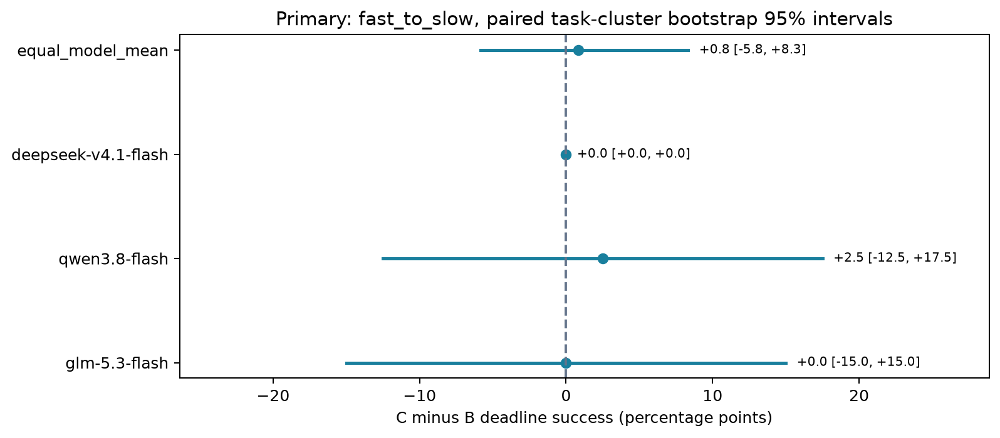

# 三模型时间摘要实验最终报告

## 结论

已执行18次修订后诊断、216次完整开发、1080次正式实验和独立144次固定上下文探针。正式主比较为工具从快变慢时，动态摘要C相对固定摘要B的截止前正确率差：三模型等权 **+0.83个百分点，95%配对任务簇bootstrap区间[−5.83,+8.33]**。目前不能确认正向收益，也不能证明等效或无效。全部失败保留，没有按正式效果改参数或补样。

C的耗时参考更接近后续工具耗时，但本轮没有建立“更准的参考→更优动作→更高完成率”的完整证据链。GLM、DeepSeek在主条件的B/C成功率较高，Qwen主要受预算内模型请求和工具等待约束；这些是所测模型与框架组合的表现，不能直接推及其他版本、agent或真实业务。

## 实现与冻结设计

实验使用自建Python串行工具Agent，通过OpenCode Go API调用 `glm-5.3-flash`、`qwen3.8-flash`、`deepseek-v4.1-flash`，没有使用OpenCode交互式agent作为执行器。Python宿主控制可见输入、工具白名单、时钟、终止和评分，模型只返回一个JSON动作。选择这一路线是为了可复核地控制实验变量，而非比较不同产品的交互能力。[Agent构造说明](Agent构造说明.md)记录完整调用链和限制。

正式矩阵为3模型×20测试任务×ABC×3延迟模式×2重复=1080。每模型360次，每模型×条件×模式40次。任务含证据检索与表格查询两个任务族。预算150秒，变化点12秒，快/慢工具目标2/15秒；每模型并发2。延迟按工具开始时刻判定，首次格式有效提交即结束，数值与证据集合同时正确且在截止前到达才算成功。

A/B/C均可见剩余时间、校准与历史耗时；A没有额外摘要，B使用初始固定均值，C使用最近最多三条完整同类工具耗时均值。研究的是摘要及动态更新的增益，不是“有无时间意识”。默认推理设置、服务端路由与模型别名背后的权重未完全固定。

诊断18/18正确；完整开发166/216正确并通过预定质量门槛。历史旧提示、非流式和旧时钟批次均单独保留，不混入正式矩阵。[执行记录](执行记录_20261030.md)记载了修复和版本边界。

## 完整结果与不确定性

| 模型 | 全部模式正确/360 | 快变慢A | 快变慢B | 快变慢C | 主要C−B（百分点） | 95%区间 |
|---|---:|---:|---:|---:|---:|---|
| GLM | 332 | 37/40 | 37/40 | 37/40 | 0.00 | [−15.00,+15.00] |
| Qwen | 224 | 13/40 | 14/40 | 15/40 | +2.50 | [−12.50,+17.50] |
| DeepSeek | 346 | 36/40 | 39/40 | 39/40 | 0.00 | [0.00,0.00] |
| 固定三模型等权 | — | — | — | — | +0.83 | [−5.83,+8.33] |

总计902/1080成功（83.52%）。938次有效提交中36次错误；117次模型超时、14次工具超时、10次环境中断、1次步骤上限。成功率高低不构成跨模型普遍排名：服务速度、模型版本和推理设置都是被测组合的一部分。

主统计按20个任务簇、证据/表格各10个分层，保留每任务的模型和重复，seed911、10000次重采样。两次重复不增加独立任务数，任务模板共享结构进一步限制推广。单模型区间为探索性，未校正多重比较。[统计JSON](../reports/go_formal_results_20261101_v1/primary_statistics.json)已与冻结源码计算逐项对照一致。

DeepSeek的40个配对里38对均成功，1对仅C成功、1对仅B成功；反向差异发生在同一任务的两次重复，20个任务均值全部为0。因此经验任务簇bootstrap退化为零宽度区间，**不代表总体不确定性为零或两方法严格等效**。总区间同时覆盖超过±5个百分点的差异，不能将本轮解释为已经排除实务上重要的收益或损失。

## 三次休眠与敏感性

正式运行分为784、159、110、27条四段，前三段分别留下6、2、2条宿主休眠环境失败。已关闭记录不重跑、不删改；每次仅继续从未启动的清单项。连续钟包含休眠，避免接收超时后的答案。`caffeinate -i`仅能防止自动空闲休眠，不能消除合盖或手动休眠。

全1080端到端分析保留这10个零分，不能把它们解释为模型能力失败。完整审计的原始pass=false对应精确核对的这10条环境记录及休眠警告；其他完整性检查通过。[原始审计](../reports/go_formal_complete-20261101T075855581236Z/audit.json)与[三次审查链](../reports/go_environment_resume-20261101T072557784168Z/review.json)均保留。

其中3条影响主B/C比较。固定其余数据，仅将这些环境端点取0或1，三模型等权差值范围为 **[0.00,+2.50]个百分点**；这是端点敏感性范围，**不是置信区间或未休眠实验的恢复值**。排除受影响配对后的等权描述值约+0.022个百分点，但这种删选有选择偏差，不替代主分析。Qwen有一对跨段；其他结局也可能受日历、服务负载影响。[敏感性与资源补充](../reports/go_formal_results_20261101_v1/environment_and_limits.md)包含精确ID、分段和各模型范围。

## 行为与机制

快变慢条件下，B对下一次同类完整工具耗时的平均绝对误差约13秒；C为GLM7.40秒、Qwen6.79秒、DeepSeek8.95秒。对应完整观测数分别为B的131/148/124、C的139/141/116，删失分别1/6/0与0/3/0。摘要统计器在更新，但仍滞后；这是行为依赖的完整调用子集，不能直接作策略理解或收益的证明。

Qwen主条件每episode模型请求跨度中位数约85–89秒，工具等待约60秒；两类中位数不可相加当作单个episode。GLM和DeepSeek请求跨度约19–21秒、工具约50–51秒。Qwen的预算约束更明显；不能把请求墙钟当纯推理耗时。完整时间分布、删失、数值/证据错误、暴露后动作、来源覆盖及C−A/B−A差值见[次要指标](../reports/go_formal_results_20261101_v1/secondary/report.md)。这些指标未作额外显著性宣称。

独立探针在主模型调用结束后运行：3模型×8冻结开发前缀×ABC×2重复=144。合成预算180秒、已过120秒、剩余60秒，实际只请求一个动作，不执行模型工具。宿主纯本地分类及证据rubric不发送给模型。144次全部闭合，无服务或环境失败。

| 模型 | A：新工具/正确提交/错提交/无效 | B | C |
|---|---|---|---|
| GLM | 14/1/1/0 | 14/0/2/0 | 13/0/2/1 |
| Qwen | 12/1/0/3 | 13/1/0/2 | 12/2/0/2 |
| DeepSeek | 14/2/0/0 | 14/2/0/0 | 14/2/0/0 |

合计120次新工具、11次正确提交、5次错误提交、8次无效动作；没有重复工具请求。预登记的工具名+arguments比较与原分类一致，重分类0次。八个前缀和两次重复仅支持单步描述：类别相同不代表参数完全相同，新工具不必然有用，正确提交也不能证明端到端适应。未观察到C在三模型一致优于B的机制模式。[探针双分类报告](../reports/go_probe_complete_20261101/request_categories/report.md)保留全部原标签和assessment。

## 资源、图表与复现

正式6892次请求尝试，已报告Go allowance小计2.61809483；缺少allowance的132次包括22次空usage和110次仅token报告，实际总用量未知，不能将缺失填0或把套餐额度说成现金收费。[资源口径](../reports/go_formal_results_20261101_v1/resource_missingness.json)与次要指标JSON保留字段级报告计数。

四张正式图的PNG与SVG均已生成；PNG直接检查，SVG经CairoSVG独立渲染检查，标题、图例、分母、截止与删失显示完整。系统Quick Look会裁切此类SVG缩略图，因此交付检查采用独立渲染结果，而不以其裁切缩略图误判原图。

- [分模式成功率](../reports/go_formal_results_20261101_v1/success_by_latency.png) · [SVG](../reports/go_formal_results_20261101_v1/success_by_latency.svg)
- [终止原因](../reports/go_formal_results_20261101_v1/outcomes.png) · [SVG](../reports/go_formal_results_20261101_v1/outcomes.svg)
- [四类首例配对时间线](../reports/go_formal_results_20261101_v1/paired_timelines.png) · [SVG](../reports/go_formal_results_20261101_v1/paired_timelines.svg)
- [主要区间SVG](../reports/go_formal_results_20261101_v1/primary_effect.svg) · [按错误类别排序首例](../reports/go_formal_results_20261101_v1/secondary/error_examples.json)

采样结束后修复了内部正式报告误用开发单元期望数12的问题：正式基础单元为60，检查结构完整性，下一阶段准入不适用。修复不改变原始轨迹、评分和主统计；诊断/开发原报告字段与冻结算法逐项一致。离线回归运行134项，133通过、1项平台跳过。[修复证据](../reports/go_formal_results_20261101_v1/post_sampling_reporting_fix_verification.json)和[回归日志](../reports/go_formal_results_20261101_v1/offline_regression.log)保留。

当前工作源码因报告修复与旧批次哈希不同，不能直接用旧批次执行入口续跑。历史分析须核验归档源码和原始哈希；不要修改快照来通过当前源守卫。README给出只读分析的复现入口。[最终验收清单](最终交付验收清单_20261101.md)逐项关联交付证据。

## 下一轮建议（尚未执行）

本轮结论是收益未确定，不能继续在同一正式集加样直到显著。下一轮仍优先保留这三个模型，先在稳定、不休眠的宿主上建立新的开发与保留测试分割，再独立登记方案。

1. **区分参考滞后与决策无收益。** 在新开发任务上比较现有最近三次均值与一种事先固定的更快更新规则，固定其它输入。先验证参考误差和可行动机会，再冻结测试；期待区分“统计器更新太慢”与“更新更准但模型决策不受益”。
2. **区分天花板与模型时间瓶颈。** GLM/DeepSeek主B/C接近天花板，Qwen等待更紧。用独立开发数据检查任务难度与预算暴露；任何预算/难度调整都作为新版本，并对三个模型遵守同一预登记规则，不用本轮测试题反向挑题。
3. **提高精度而非只堆重复。** 在新独立任务上先规定希望达到的区间宽度和最大预算，用开发任务簇方差仿真确定固定规模与停止规则；不依据中途效果决定追加。不得把模板重复当独立任务扩容。
4. **更直接检验行动机制。** 预先构造确有多种可行行动、且耗时变化可能改变选择的公开前缀，定义可接受动作集合及证据约束；比较具体参数与后续短程完成表现。不能把调用更少直接设为“好动作”。

这些是基于结果的后续研究提议，尚未启动新的付费调用，也不属于本轮1224条正式/探针样本。
