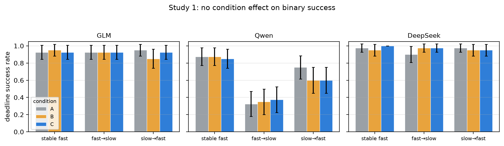
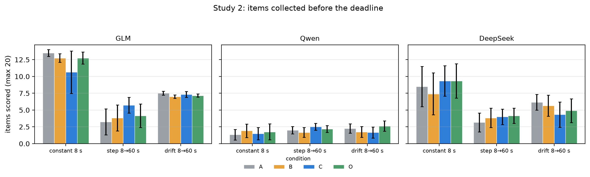
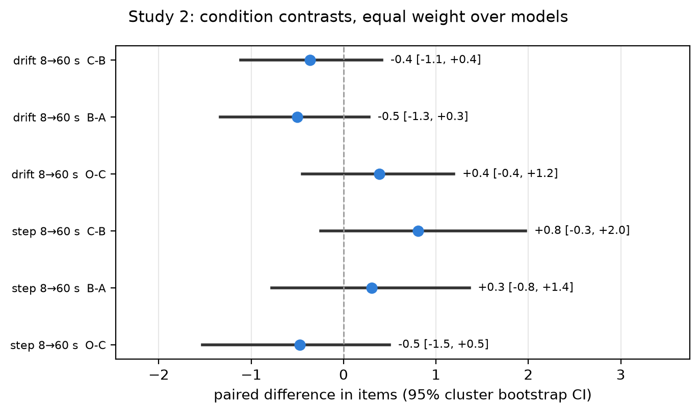
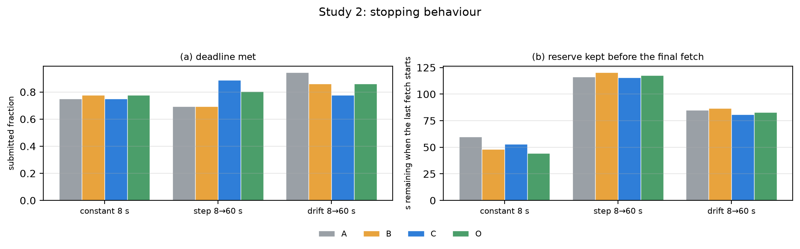
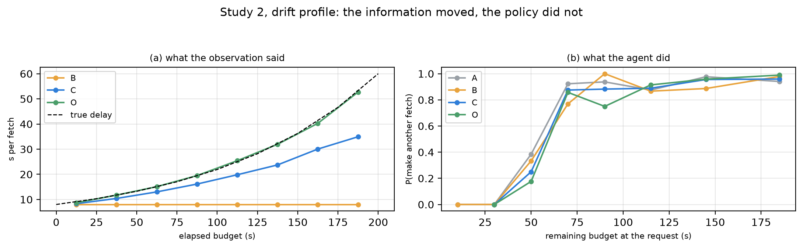
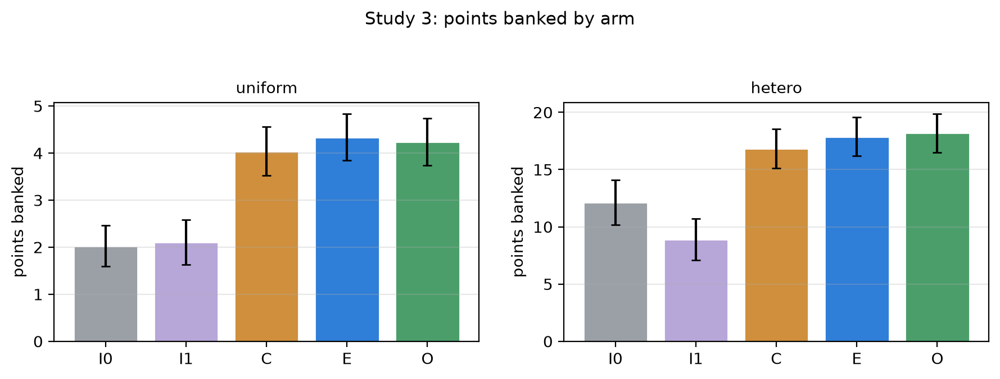
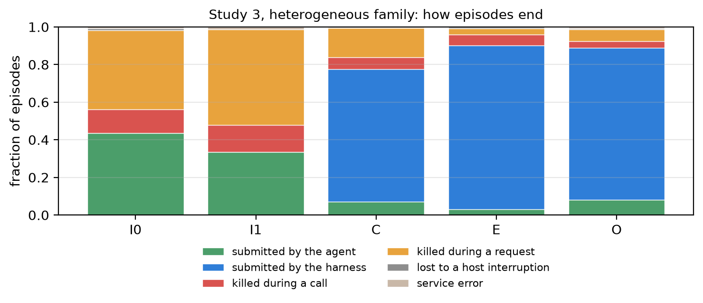
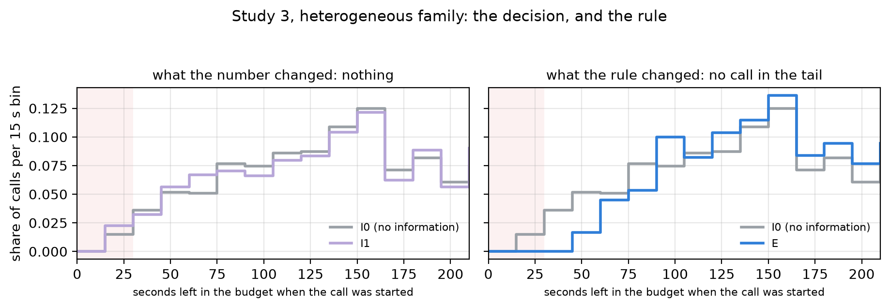
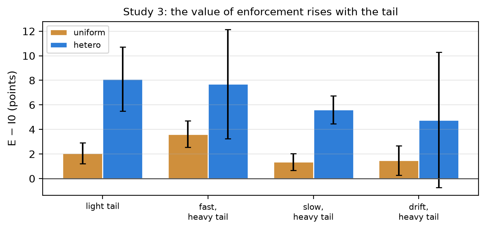

# What Stops an Agent? Information, Commitment and Enforcement under a Deadline

**Anonymous submission**

---

## Abstract

Agents that call tools under a wall-clock budget must decide when to stop gathering information. A natural interface intervention is to summarise the latency observed so far — as a fixed prior or as a running estimate — so that the agent can plan its remaining time. We test this intervention and its alternatives in three pre-registered studies with four production language models, 3,703 episodes in total, with deterministic host-injected scoring and paired within-task comparisons.

Study 1 (1,080 episodes; evidence retrieval with binary scoring) found no improvement from an adaptively updated summary over a static prior: the equal-weight difference in deadline success was +0.83 percentage points, 95% cluster-bootstrap CI [−5.83, +8.33]. The null was a property of the design, not of the models. The task admitted only one scoring policy, so the estimate could not change the optimal action; every per-call duration was already in the visible history, so the summary was a function of data on screen; and 91.0% of successful episodes finished with 30 s or more of a 150 s budget unspent.

Study 2 (432 episodes) removes both defects. In a partial-credit task the agent stops whenever it likes and keeps what it has, so the expected cost of the next call determines the optimal stopping point. The four conditions differ in exactly one field: no reference, a static prior, a last-observation estimate, or a perfect oracle. The manipulation was strong — mean absolute reference error 8.0 s, 3.6 s and 1.5 s while the true cost drifted from 8 s to 60 s — and the effect was nil: −0.36 items, 95% CI [−1.1, +0.4], p = 0.44. Behaviour was unchanged as well: the probability of starting another fetch was a function of the remaining budget alone. Given the stale prior, a simulated planner would have collected 2.2 items; the agents collected 7.0, and under the oracle 7.2 against the planner's 7.2.

Study 3 (2,191 episodes) asks what still matters once the agent already has a clock. A model never observes its own inference latency; the harness measures it directly. Across five arms that run identical code — no information; full information including the agent's own measured request latency; a reserve the agent declares; a reserve the harness computes; and the same rule with a perfect cost model — enforcing a deadline reserve raised the points banked by +6.08 (95% CI [+4.91, +7.36], p = 0.0005), and it made no difference whether the reserve came from the harness or from the agent's own declaration (-1.83, 95% CI [-3.97, +0.25]); information alone, including the agent's own measured request latency, made the score worse (-3.70, 95% CI [-6.04, -1.95]).

Agents with a clock already extract the cost of their tools. What they cannot extract is the cost of
themselves, and what they cannot do is bind their future self to it. A reserve that is *enforced* —
whoever sets it — converts deadline failures into scored work; the same number supplied as
information does not.

## 1. Introduction

Tool-using language-model agents are increasingly deployed against deadlines: a request must be answered before a client timeout, a report filed before a cut-off, a plan executed before a reservation expires. The agent observes a wall clock and a stream of tool results, and it must decide, at every step, whether to spend more time on evidence or to commit to an answer.

A recurring proposal in agent engineering is to make latency explicit. Instead of leaving the agent to infer how long calls take, the harness computes a summary — the mean duration of the tools it has called, perhaps with a fixed prior from calibration — and places it in the observation next to the remaining budget. The intuition is that the agent will then plan: with 60 s left and calls costing 45 s, it should stop; with 60 s left and calls costing 3 s, it should continue.

This paper asks whether that intuition survives contact with real models. We ran three pre-registered, paired, fully instrumented studies with four models served through a single API (GLM-5.3-Flash, Qwen3.8-Flash, DeepSeek-V4.1-Flash and MiMo-V2.6-Flash), and with call latency injected by the host so that the true cost of every call is known to the experimenter: 1,512 episodes in the first two studies and 2,191 in the third.

Study 1 was a conventional design: retrieve a set of documents or join two tables, compute a value, submit the value together with exactly the source identifiers that support it. Across 1080 episodes the adaptive summary did not beat the static prior, and neither differed from no summary at all.

Rather than adding samples, we asked why. Three properties of the design make a null result the only possible outcome, and none of them is about model capability:

1. **No decision leverage.** Success required every required row. Stopping early guaranteed failure, so the set of actions that could score was the same for every possible latency belief. A summary can only matter if the optimal action depends on it.
2. **Ceiling.** Two of the three models succeeded on 92% and 96% of episodes in the primary condition, leaving little room for a difference.
3. **Redundancy.** The visible history already contained the exact duration of every completed call, and the adaptive summary was the mean of the last three of those numbers. The interface handed the agent a statistic it could compute, and did compute.

Study 2 therefore rebuilds the environment around the first property: a partial-credit task in which the agent fetches items one at a time and may stop whenever it likes, keeping everything it has collected. Now the optimal stopping point is a function of the expected cost of the next call, and a stale estimate causes overrun. We contrast four information conditions that differ in exactly one field of the observation — no reference, a static prior, an adaptive estimate, and a perfect oracle — over three latency trajectories, including a geometric drift in which the most recent observation always underestimates the next call.

The information manipulation was large and the behavioural effect was nil. Displayed-reference error fell from 8.0 s to 3.6 s to 1.5 s across the four conditions while the true cost drifted from 8 s to 60 s, and yet the paired difference between the adaptive and the static condition was −0.36 items out of 20 (95% CI [−1.1, +0.4]). The stopping threshold — the remaining budget at which the agent will still start another fetch — moved by less than the width of the confidence interval across conditions. What tracks the outcome is not the estimate the agent was given but the estimate it can read off the clock: agents given the stale prior collected 7.0 items where a planner holding that same prior would have collected 2.2.

That result raises the obvious objection. If the agent already reads the clock, why does it still fail? In Study 2 between 14% and 27% of episodes ended without a submission, and the fatal decision was almost always the last fetch. Something about time is missing from the model's picture, and it is not the cost of the tool.

Study 3 locates it. A model never observes how long *it* takes: every observation arrives after its own inference has already happened, so elapsed time mixes thinking and execution with no way to separate them. The harness measures request latency directly — but measuring it and *saying* it are different acts. Study 3 therefore separates the two. Five arms run identical episode code: no information; full information including the agent's own measured latency; a reserve the agent declares and the harness enforces; a reserve the harness computes and enforces; and the same rule with a perfect cost model. Across 2,191 episodes, with a control in which call durations are nearly deterministic, enforcing a deadline reserve raised the points banked by +6.08 (95% CI [+4.91, +7.36], p = 0.0005); information alone, including the agent's own measured request latency, made the score worse (-3.70, 95% CI [-6.04, -1.95]), and it made no difference whether the declared reserve came from the agent or from the harness (-1.83, 95% CI [-3.97, +0.25]).

Our contributions are:

- A 1080-episode paired null for latency summaries, with a design-level diagnosis that identifies decision leverage and information redundancy as the binding constraints (§3).
- A 432-episode experiment in which the same intervention is given real decision leverage, and a precise null: the estimate moved, the behaviour and the outcome did not (§4).
- A 2,191-episode experiment that isolates the one piece of time information a model cannot obtain for itself, and shows that what changes deadline behaviour is enforcement rather than information: a mechanically enforced reserve gains +6.08 points while the same information given to the agent cost the score 3.70 points (95% CI [-6.04, -1.95]) (§5).
- The distinction between the *declared* estimate an interface supplies and the *operative* estimate an agent acts on, and its consequence for harness design: put the clock in the harness (§6).

## 2. Related work

**Metareasoning and value of computation.** The idea that an agent should reason about the cost of its own computation goes back to deliberation scheduling and metareasoning [Boddy & Dean 1994; Russell & Wefald 1991], to reasoning under resource constraints [Horvitz 1988], and to anytime algorithms whose quality improves with time [Zilberstein 1996]. That literature is explicit that the value of a cost estimate is instrumental: it matters only through the action it changes. Our Study 1 is, in effect, a case in which the instrument has no purchase.

**Time and cost in LLM agents.** Work on tool-using agents [Schick et al. 2023; Yao et al. 2023a] and on iterative self-correction [Shinn et al. 2023] largely reports accuracy at unlimited budget. Benchmarks that do impose budgets [Jimenez et al. 2024; Yao et al. 2024; Zhou et al. 2024] evaluate end-to-end success, and cost is usually reported post hoc rather than manipulated. Recent critiques argue that agent evaluation must treat cost as a first-class axis [Kapoor et al. 2024]. We take the complementary step: we manipulate the *information* the agent has about cost, holding the environment fixed.

**Interface interventions.** Chain-of-thought and its variants [Wei et al. 2022; Yao et al. 2023b] show that the shape of the observation changes what the model does. Our question is narrower and more mechanical: given that the agent can already see a clock and a history of durations, does an explicit summary of those durations change its stopping behaviour?

**Concurrent work on stopping and on budgeted agents.** Two 2026 papers are close to ours and delimit what is new here. Zhang et al. show that tool-using agents rarely convert their own evidence judgements into a stopping decision, that prompt cues change *when* they stop but not *what* they stop on, and that a harness-enforced integration step is what finally binds the behaviour [Zhang et al. 2026]. Wang et al. show that small agents given a budget only in the prompt fail to respect it, that harness-injected timing information improves budget adherence, and that enforcement tightens it further, while agents still fail to use extra time productively [Wang et al. 2026]. Our studies are complementary in a specific way. Wang et al. add timing feedback to a harness that had none; we hold the clock fixed and vary what is *derived* from it, finding that the derived estimate adds nothing once the clock is there. Zhang et al. show that a harness-enforced step binds behaviour where prompts do not; we show which harness-side quantity has to be enforced, namely a reserve that covers the model's own request latency, and that giving the agent that same number as information does not reproduce the effect. Latency-aware routing among equivalent providers [Chu et al. 2026] addresses the orthogonal question of which tool to call rather than when to stop.

## 3. Study 1: latency summaries without decision leverage

### 3.1 Environment

Each episode presents a question, a set of tools, and a wall-clock budget of 150 s. Two task families were used. In the *evidence* family the agent must locate three documents with a keyword search, read each one, and compute a value (sum, weighted difference, range, product, or ratio). In the *table* family the agent must join two tables, filter both, and compute an aggregate. In both families the submission must contain the value *and* exactly the set of source row identifiers that support it; a superset or subset is scored as wrong.

The host executes tools; the model only emits one JSON action per request, either `{"type":"tool",...}` or `{"type":"submit",...}`. Tool execution is instantaneous, and the host injects the remainder of a target duration with a non-busy sleep, so the wall-clock cost of a call is exactly what the experimenter chose.

Three latency profiles were used: `stable_fast` (2 s throughout), `fast_to_slow` (2 s, then 15 s after 8% of the budget), and `slow_to_fast` (15 s, then 2 s).

### 3.2 Conditions

All conditions saw the question, the tool schemas, the calibration samples, the remaining time, and the full history of actions, tool results, and per-call durations. They differed in one field:

- **A**: no duration reference.
- **B**: a static per-tool mean of pre-episode calibration samples.
- **C**: a per-tool mean of the last three completed calls, falling back to calibration.

### 3.3 Design and analysis

The formal matrix was 3 models × 20 test tasks × 3 conditions × 3 profiles × 2 repeats = 1080 episodes. Conditions were run back to back within a block, in rotated order. The pre-registered primary estimand was the `fast_to_slow` difference in deadline success between C and B, averaged with equal weight over the three models, with a paired cluster bootstrap over the 20 task clusters (10,000 draws, seed 911). All failures were retained, including ten episodes lost to host sleep; a sensitivity analysis varied those endpoints between 0 and 1.

### 3.4 Results

Table 1 and Figure 1 give the outcome. Of 1080 episodes, 902 succeeded. The primary contrast was +0.83 percentage points with a 95% interval of [−5.83, +8.33].

**Table 1. Study 1, deadline success by model and condition in the primary profile (`fast_to_slow`), n = 40 per cell.**

| Model | A | B | C | C−B (pp) | 95% CI |
|---|---:|---:|---:|---:|---|
| GLM-5.3-Flash | 37/40 | 37/40 | 37/40 | 0.00 | [−15.0, +15.0] |
| Qwen3.8-Flash | 13/40 | 14/40 | 15/40 | +2.50 | [−12.5, +17.5] |
| DeepSeek-V4.1-Flash | 36/40 | 39/40 | 39/40 | 0.00 | [0.0, 0.0] |
| Equal weight | — | — | — | +0.83 | [−5.83, +8.33] |

The DeepSeek interval is degenerate because the 40 paired comparisons reduce to 20 task-level means that are all exactly zero: the one pair in which only B succeeded and the one pair in which only C succeeded fall within the same task, so they cancel at the level of the inference unit. We report this as a property of the estimator, not as evidence of equivalence.

**Figure 1.** Deadline success by condition, profile, and model. The only systematic pattern is Qwen's lower success in `fast_to_slow`, which is a budget effect: its median request took 11.0 s against 2.8 s and 3.2 s for the other two models.

### 3.5 Why the null was predictable

Three features of Study 1 make a null the expected outcome. We state them because they generalise: they are properties a designer can check before running an experiment.

**(i) The optimal action did not depend on the latency estimate.** In both task families the only way to score was to collect *every* required row and then submit. Let $d$ be the latency estimate, $R$ the remaining time and $\pi^\*(d)$ the optimal policy. For any $d$, $\pi^\*$ is "collect the remaining required rows, then submit"; the estimate enters only through a comparison that determines whether the episode is feasible at all. An agent that stops early with a partial evidence set scores zero with probability one. Consequently the mapping from estimate to outcome is flat over the region where the agent has any chance of success, and the intervention cannot pay. This is the decision-leverage condition, and it is the one we fix in Study 2.

The outcome data confirm that the deadline was rarely the operative constraint. Of the 902 successful episodes, the median finished with 96.2 s of its 150 s budget unspent; only 1.2% finished with less than 5 s left and 7.4% with less than 20 s. A perfect latency oracle could not have improved those episodes, because they were already complete with room to spare. Of the 178 failures, 36 were *wrong answers submitted in time* — a reasoning error that no timing information addresses — and 117 were requests cut off by the deadline, almost all of them Qwen's, whose median request took 11.0 s against 2.8 s and 3.2 s for the other two models.

**(ii) The outcome was near its ceiling.** GLM and DeepSeek succeeded on 92.2% and 96.1% of all episodes, and 92.5%/97.5% in the primary profile. With $n=40$ per cell, a five-point difference is at the edge of what a paired design can resolve.

**(iii) The summary was redundant with the observation.** The history shown to the model contained, for every completed call, a `duration_s` field holding the exact wall-clock duration. Condition C's reference was the mean of the last three of those fields; condition B's was the mean of three pre-episode samples that were also shown, in `calibration_samples_s`. The interface therefore added no information that was not already present, only a pre-computed statistic. The measured error of the reference fell from about 13 s (B) to 7.4/6.8/9.0 s (C) for the three models, but the agent could have obtained the smaller error itself from data on screen.

The behavioural record is consistent with this reading: in `fast_to_slow`, the mean remaining time at the end of an episode was 73.5 s (A), 56.8 s (B) and 66.6 s (C) for GLM out of a 150 s budget, i.e. the models stopped with roughly half the budget unspent regardless of what the summary said.

## 4. Study 2: creating decision leverage

### 4.1 Task

Study 2 replaces the all-or-nothing retrieval task with a deadline-budgeted accumulation task. An episode presents 20 opaque item identifiers (K01–K20) and a 200 s budget. A single tool, `fetch(item_id)`, returns a four-digit integer for one item and consumes a host-injected duration. The agent may reply `{"type":"submit"}` at any moment; the host then scores the number of distinct items it has actually handed out, one point each, and ends the episode. If the budget expires before a submission is processed, the episode scores zero and everything collected is lost.

Two properties make the latency estimate consequential. First, partial credit exists, so stopping is a real action with a real payoff. Second, the submission is itself a request and therefore costs time, so the agent must reserve time for it — a reserve that depends on how expensive calls currently are.

The submission carries no payload. An earlier pilot used a payload-bearing submission in which the agent restated the items it had collected; one model fetched seven values and then submitted one, so that design measured the model's ability to re-emit a growing dictionary rather than its stopping decision. The host-side scoring removes that confound, and `collected_items` (the running list, its count, and the number remaining) is displayed in every condition.

### 4.2 Latency profiles

The cost of a call is fixed at the moment the call starts:

- `stable_fast`: 8 s throughout. The prior is correct and no adaptation is needed; this is the control.
- `fast_to_slow`: 8 s until 30% of the budget, then 60 s. A step change, discoverable from a single observation.
- `drift_up`: $d(t) = 8 \cdot 7.5^{t/200}$ s, a geometric drift from 8 s to 60 s. The most recent observation always underestimates the next call.

`drift_up` is the primary profile. The reasoning is that a step change is absorbed by one observation, so a reactive summary can only repeat what the trace already shows, whereas geometric drift creates a belief bias that persists for the whole episode. Only in the latter structure can a summary have a sustained effect on the number of items collected.

### 4.3 Information ladder

All four conditions see the same question, tools, budget, clock, history, and `collected_items`. They differ in one field of the observation:

- **A**: no `duration_reference_s`.
- **B**: the static prior, i.e. the pre-episode calibration mean (8 s).
- **C**: the most recent completed call's duration, falling back to the prior before the first call.
- **O**: the delay the host is applying at the moment of the request — a perfect instantaneous oracle. O is not deployable; it is the information upper bound, and the gap O−C measures how much of the achievable value remains when the estimate is correct but not anticipatory.

The window for C was set to one. With a three-call window (as in Study 1) a single 60 s call is diluted by two 8 s calls, and the displayed estimate is 25 s when the truth is 60 s; the interface effect would then be confounded with estimator lag.

### 4.4 Design validation

Before the formal batch we simulated a rational planner under each belief, resampling request wall times from the per-model empirical distributions of Study 1. The simulation serves as a design check: if the simulated gap between B and C were zero, no interface could matter and the study would be uninformative by construction.

**Table 2. Simulated expected items for a rational planner (200 s budget, 600–800 replications per cell).**

| Profile | B | C | O |
|---|---:|---:|---:|
| `stable_fast` (GLM / DeepSeek / Qwen) | 14.9 / 15.3 / 6.0 | 14.9 / 15.3 / 6.0 | 14.9 / 15.3 / 6.0 |
| `fast_to_slow` | 5.3 / 5.5 / 0.6 | 7.1 / 7.1 / 3.4 | 7.1 / 7.1 / 3.4 |
| `drift_up` | 2.1 / 2.8 / 2.4 | 7.3 / 7.3 / 3.9 | 8.5 / 8.6 / 4.6 |

Two of the three pre-registered checks are met cleanly: no simulated cell reaches the 20-item ceiling, and C's expected score in `drift_up` exceeds three for the two models whose inference is fast. The first check — an actionable gap of at least three items between C and B — holds for GLM (5.2) and DeepSeek (4.5) but not for Qwen (1.5), whose 18.9 s median request latency leaves room for only a handful of calls whatever the belief. We report this rather than adjusting the environment, and treat Qwen's arm as a low-power replication throughout. The numbers in this table resample Study 1 request latencies; Table 6 recomputes the same planners with the latencies measured inside Study 2, which are 1.4–1.7× slower, so the design-time figures are optimistic by one to two items.

### 4.5 Protocol

The formal matrix was 3 models × 12 test tasks × 3 profiles × 4 conditions = 432 episodes, one repeat, with the four conditions of a block run adjacently in rotated order. The primary estimand was the `drift_up` C−B difference in items, equal weight over models, with a paired cluster bootstrap over the 12 task clusters (10,000 draws, seed 911) and a sign-flip randomisation test (2,000 permutations). Parameters, hypotheses, and the analysis plan were written down before the batch started and were not modified afterwards.

### 4.6 Results

All 432 planned episodes are accounted for. 426 produced a scored result and 6 are archived host-suspend failures, retained with a zero score and flagged separately; they are included in every denominator and never interpreted as model behaviour. Table 3 gives the items banked before the deadline, averaged over the twelve task instances.

**Table 3. Study 2, mean items collected (maximum 20), n = 12 per cell.**

| Profile | Model | A | B | C | O |
|---|---|---:|---:|---:|---:|
| constant 8 s | GLM | 13.5 | 12.8 | 9.8 | 12.8 |
| constant 8 s | Qwen | 1.3 | 1.9 | 1.5 | 1.8 |
| constant 8 s | DeepSeek | 7.1 | 7.4 | 9.3 | 9.3 |
| step 8→60 s | GLM | 3.2 | 3.8 | 5.2 | 4.2 |
| step 8→60 s | Qwen | 2.0 | 1.7 | 2.5 | 2.0 |
| step 8→60 s | DeepSeek | 3.2 | 3.8 | 4.0 | 4.2 |
| drift 8→60 s | GLM | 7.5 | 7.0 | 7.3 | 7.2 |
| drift 8→60 s | Qwen | 2.2 | 1.8 | 1.7 | 2.4 |
| drift 8→60 s | DeepSeek | 6.2 | 5.7 | 4.3 | 4.9 |

**Figure 2.** Items collected before the deadline, by profile, condition and model; error bars are 95% normal-approximation intervals over twelve episodes.

**Primary contrast.** In the drift profile — the one profile in which the most recent observation is systematically stale — the equal-weight C−B difference was -0.36 items, 95% cluster-bootstrap CI [-1.1, +0.4], sign-flip p = 0.442 over 12 paired blocks. Per model: GLM +0.3, Qwen -0.1, DeepSeek -1.3.

**All pre-registered contrasts.** Of the 9 contrasts in Table 4, 1 has a 95% interval excluding zero. The largest point estimate is C-A in the drift 8→60 s profile at -0.9 items, CI [-1.6, -0.0]. In the control profile, where all four conditions display the same number, the C−B estimate is -0.5 items.

**Table 4. Study 2, paired contrasts in items (95% cluster bootstrap CI).**

| Profile | Contrast | Pooled | 95% CI | p | GLM | Qwen | DeepSeek |
|---|---|---:|---|---:|---:|---:|---:|
| drift 8→60 s | C-B | -0.4 | [-1.1, +0.4] | 0.442 | +0.3 | -0.1 | -1.3 |
| drift 8→60 s | B-A | -0.5 | [-1.3, +0.3] | 0.303 | -0.5 | -0.5 | -0.5 |
| drift 8→60 s | C-A | -0.9 | [-1.6, -0.0] | 0.078 | -0.2 | -0.6 | -1.8 |
| drift 8→60 s | O-C | +0.4 | [-0.4, +1.2] | 0.425 | -0.2 | +0.8 | +0.6 |
| drift 8→60 s | O-B | +0.0 | [-1.0, +1.0] | 0.983 | +0.2 | +0.7 | -0.8 |
| step 8→60 s | C-B | +0.8 | [-0.3, +2.0] | 0.224 | +1.4 | +0.8 | +0.2 |
| step 8→60 s | B-A | +0.3 | [-0.8, +1.4] | 0.560 | +0.6 | -0.3 | +0.7 |
| step 8→60 s | O-C | -0.5 | [-1.5, +0.5] | 0.424 | -1.1 | -0.5 | +0.2 |
| constant 8 s | C-B | -0.5 | [-2.0, +0.9] | 0.523 | -3.0 | -0.4 | +1.9 |

**Figure 3.** Paired contrasts in items, equal weight over the three models, with 95% cluster-bootstrap intervals. The dashed line is zero.

**The manipulation changed what the agents were told.** In the drift profile the mean absolute error between the displayed reference and the delay actually applied was 8.0 s in condition B, 3.6 s in C and 1.5 s in O (Figure 5a). B's reference stayed at 8.0 s for the whole episode while the true cost rose to 60 s; C's tracked the truth with roughly one call of lag; O coincided with it.

**It did not change what they did.** The fitted stopping threshold — the remaining budget at which the probability of starting another fetch crosses one half — was 56.8 s in A, 54.9 s in B, 57.9 s in C and 62.0 s in O (Table 5). The four curves in Figure 5b lie on top of one another: the decision to continue is a function of the remaining budget, not of the estimate the model was handed.

**Table 5. Study 2, stopping behaviour.**

| Profile | Cond | submitted | threshold (s) | mean reference (s) | mean fetches | regret (items) |
|---|---|---:|---:|---:|---:|---:|
| constant 8 s | A | 0.75 | 8.1 | — | 8.2 | 0.78 |
| constant 8 s | B | 0.78 | 7.1 | 8.0 | 8.8 | 1.42 |
| constant 8 s | C | 0.75 | 15.1 | 8.0 | 8.3 | 1.42 |
| constant 8 s | O | 0.78 | 13.3 | 8.0 | 8.9 | 0.97 |
| step 8→60 s | A | 0.69 | 68.6 | — | 4.4 | 1.56 |
| step 8→60 s | B | 0.69 | 68.7 | 8.0 | 4.5 | 1.36 |
| step 8→60 s | C | 0.89 | 84.2 | 18.1 | 4.4 | 0.39 |
| step 8→60 s | O | 0.81 | 84.7 | 23.1 | 4.4 | 0.81 |
| drift 8→60 s | A | 0.94 | 56.8 | — | 5.7 | 0.31 |
| drift 8→60 s | B | 0.86 | 54.9 | 8.0 | 5.5 | 0.67 |
| drift 8→60 s | C | 0.78 | 57.9 | 14.4 | 5.5 | 1.03 |
| drift 8→60 s | O | 0.86 | 62.0 | 18.0 | 5.5 | 0.67 |

**Figure 4.** Stopping behaviour. (a) The fraction of episodes that reached the deadline with a submission. (b) The remaining budget at which the final fetch was started; larger values mean a larger reserve was kept.

**Where the items go.** The submission rate ranges from 0.69 to 0.94 across the twelve profile–condition cells, and the mean regret of continuing — the gap between what the episode scored and what stopping at the best earlier request would have banked — ranges from 0.31 to 1.56 items. Episodes are lost by over-running the deadline, not by mis-estimating the tool.

**Table 6. Simulated rational planner versus the observed agents, drift profile.**

| Model | planner B | planner C | planner O | observed A | observed B | observed C | observed O |
|---|---:|---:|---:|---:|---:|---:|---:|
| GLM | 2.2 | 5.8 | 7.2 | 7.5 | 7.0 | 7.3 | 7.2 |
| Qwen | 2.0 | 2.8 | 3.2 | 2.2 | 1.8 | 1.7 | 2.4 |
| DeepSeek | 2.3 | 5.0 | 6.0 | 6.2 | 5.7 | 4.3 | 4.9 |

**Figure 5.** The information moved and the policy did not. (a) The reference each condition displayed over the episode, against the true delay (dashed). (b) The probability of starting another fetch, against the remaining budget, for every condition.

**Which belief did the agent act on?** The three planners differ only in what they believe about the next call, and they are ordered as expected: a planner holding the stale prior collects 2.0–2.3 items, one holding the last-observation estimate 2.8–5.8, and one holding the oracle 3.2–7.2. The agents do not follow that order. Within a model, the difference between the stale-prior and oracle conditions is at most 0.8 items for the agents (0.2, 0.7, 0.8) against 1.2–4.9 items for the planners. Every observed condition lies within 1.7 items of the reaction-based planner, and in the oracle condition the agents are within 1.1 items of the planner that holds the same information. The interface changed the estimate the agent was told to hold; it did not change the estimate the agent acted on, which is the one it reads off the clock.

## 5. Study 3: enforcement, not information

Study 2 left a clear question. Agents given a stale prior, an accurate estimate and a perfect oracle all behaved the same, because each of them read the cost off the clock. If the model does not use the estimate, does it use anything? The failure record says yes: in Study 2 between 14% and 27% of episodes ended without a submission, and the failing decision was almost always the last fetch. Something is missing from the model's picture of time, and the estimate being redundant with the clock does not tell us what.

The answer is the one quantity a model never observes: how long *it* takes. Every observation a model receives is a snapshot taken after its own inference has already happened, so the model sees the sum of its thinking and the tool's execution without a way to separate them. The harness measures the request latency directly. Study 3 asks whether that asymmetry is the thing that matters, and whether *saying* it can substitute for *enforcing* it: five arms compare no information, full information that includes the agent's own measured request latency, and three ways of actually executing a reserve.

### 5.1 Task

Each episode presents 14–18 items and a wall-clock budget drawn from {150, 180, 210} s. A single tool, `fetch(item_id)`, banks the item's points and consumes a duration drawn at the moment of the call from a heavy-tailed log-normal. The agent may submit at any time and keeps everything banked.

Two families make the decision harder in different ways. In `uniform`, every item is worth one point and all calls share one latency distribution, so the only decision is how many calls to attempt. In `hetero`, every item carries a public value in {1, 3, 5} and a public size label in {S, M, L}; latency is drawn from a size-specific distribution whose mean is redrawn for every task and is never shown. A large item is worth more and may end the episode, so the agent must trade value density against time.

Four latency regimes separate the two mechanisms at play. `light_tail` makes durations almost deterministic (sigma = 0.15): an agent that has seen one call knows the next one. The other three share the heavy tail (sigma = 1.0) that makes a single observation a poor forecast — `fast_heavy`, `slow_heavy` (three times slower) and `drift_heavy` (the mean rises linearly from 1× to 3× across the episode).

### 5.2 Five arms, one rule

All five arms accept the same three actions — `fetch`, `submit`, and `commit` — and run the same episode code. The arms differ in what the harness does with the clock.

| Arm | What the observation adds | What the harness does |
|---|---|---|
| `I0` | nothing | nothing |
| `I1` | per-size cost estimates (n, mean, p90), the three most efficient remaining items, and **the agent's own median request latency** | nothing |
| `C` | as `I1` | requires a `commit{reserve_s}` before the first fetch, then enforces **the number the agent declared** |
| `E` | as `I1` | enforces a reserve the harness computes from its own measurements, and refuses fetches that cannot finish before that reserve |
| `O` | as `I1` | enforces the same rule with a perfect cost model, using the true per-size distribution |

`C`, `E` and `O` run the *same* enforcement code: refuse a call whose conservative cost leaves less than the reserve, and submit on the agent's behalf once nothing affordable remains. The only difference between them is where the reserve comes from — the agent's declaration, the harness's measurements, or the true distribution. That is what separates "is the rule right?" from "who applies it?".

The reserve must cover one more *request*, not one more tool call, because the harness can only submit between requests and the submission is itself a request. `E` therefore sets `reserve = max(1.5 × p90(request latency), median(request latency) + 4, 6 s)`. This is the design detail that took two pilots to get right: with a reserve that covered only the tool, the harness still lost episodes to the model's own inference, and the arms did not separate.

### 5.3 Protocol

The pre-registered matrix is four models × two families × 16 task instances per family × four regimes × five arms, with three repeats for GLM, DeepSeek and MiMo and two for Qwen, whose request latency makes it the throughput bottleneck; 7,040 episodes planned; 2,191 were completed and scored, the remainder unfinished when data collection ended. A block is one (model, task instance, regime) and runs the five arms back to back with the arm order rotated across positions; a cell accumulates two or three such blocks, and the repeats are averaged inside the cell before any pairing, because each repeat is an independent draw of the same stochastic environment rather than a third of a fixed quantity. The primary estimand is the `hetero`, all-regime difference between `E` and `I0` in banked points, equal weight over the four models, with a block-cluster paired bootstrap (10,000 draws, seed 911) and a sign-flip randomisation test. `light_tail` is the pre-registered negative control: if enforcement works by protecting against a tail the agent cannot foresee, it should do little when there is no tail.

### 5.4 Results

Of the 7040 planned episodes, 2191 are accounted for: 2183 scored and 8 archived host-suspend failures, retained at zero and flagged. Table 7 gives the points banked by family, regime and arm.

**Table 7. Study 3, mean points banked (maximum 5 × number of items).**

| Family | Regime | I0 | I1 | C | E | O |
|---|---|---:|---:|---:|---:|---:|
| uniform | light tail | 3.5 | 2.3 | 4.9 | 5.6 | 5.6 |
| uniform | fast, heavy tail | 1.9 | 2.3 | 5.6 | 6.0 | 5.5 |
| uniform | slow, heavy tail | 1.1 | 1.6 | 2.1 | 2.4 | 2.8 |
| uniform | drifting, heavy tail | 2.2 | 2.3 | 4.0 | 3.7 | 3.6 |
| hetero | light tail | 13.0 | 8.8 | 21.1 | 21.5 | 20.9 |
| hetero | fast, heavy tail | 15.3 | 12.1 | 18.0 | 20.7 | 21.0 |
| hetero | slow, heavy tail | 10.0 | 6.3 | 14.7 | 14.1 | 14.8 |
| hetero | drifting, heavy tail | 10.9 | 9.5 | 14.6 | 16.2 | 17.1 |

**Figure 6.** Study 3, points banked by arm, in the uniform and heterogeneous families; bars are means with 95% normal-approximation intervals over episodes.

**Primary contrast.** In the heterogeneous family, the equal-weight E−I0 difference was +6.08 points, 95% cluster-bootstrap CI [+4.91, +7.36], sign-flip p = 0.000 over 16 paired blocks. Per model: GLM +0.16, Qwen +5.71, DeepSeek +8.99, MiMo +9.47.

**Table 8. Study 3, pre-registered contrasts (points, 95% cluster bootstrap CI).**

| Family | Contrast | Pooled | 95% CI | p | GLM | Qwen | DeepSeek | MiMo |
|---|---|---:|---|---:|---:|---:|---:|---:|
| uniform | E−I0 | +2.13 | [+1.63, +2.63] | 0.000 | +1.66 | +1.14 | +3.02 | +2.71 |
| uniform | I1−I0 | -0.10 | [-0.57, +0.35] | 0.602 | -1.38 | +0.04 | +0.84 | +0.08 |
| uniform | C−I0 | +1.95 | [+1.35, +2.57] | 0.000 | +1.37 | +0.78 | +3.12 | +2.55 |
| uniform | C−E | -0.18 | [-0.58, +0.22] | 0.385 | -0.29 | -0.37 | +0.09 | -0.15 |
| uniform | E−O | -0.11 | [-0.59, +0.61] | 0.747 | -0.07 | +0.07 | -0.38 | -0.06 |
| hetero | E−I0 | +6.08 | [+4.91, +7.36] | 0.000 | +0.16 | +5.71 | +8.99 | +9.47 |
| hetero | I1−I0 | -3.70 | [-6.04, -1.95] | 0.000 | -7.60 | +0.62 | -4.64 | -3.19 |
| hetero | C−I0 | +4.25 | [+2.27, +6.01] | 0.000 | -1.00 | +3.38 | +4.01 | +10.63 |
| hetero | C−E | -1.83 | [-3.97, +0.25] | 0.122 | -1.17 | -2.33 | -4.98 | +1.16 |
| hetero | E−O | -0.15 | [-1.61, +1.25] | 0.856 | -1.84 | -0.04 | +0.79 | +0.50 |

**Table 9. Study 3, why episodes end.**

| Family | Arm | submitted | forced | mean banked items | mean denied fetches |
|---|---|---:|---:|---:|---:|
| uniform | I0 | 0.34 | 0.00 | 2.0 | 0.0 |
| uniform | I1 | 0.32 | 0.00 | 2.1 | 0.0 |
| uniform | C | 0.73 | 0.68 | 4.0 | 1.1 |
| uniform | E | 0.92 | 0.90 | 4.3 | 0.3 |
| uniform | O | 0.92 | 0.89 | 4.2 | 0.3 |
| hetero | I0 | 0.43 | 0.00 | 2.9 | 0.0 |
| hetero | I1 | 0.34 | 0.00 | 2.2 | 0.0 |
| hetero | C | 0.78 | 0.71 | 3.9 | 1.3 |
| hetero | E | 0.90 | 0.87 | 4.2 | 0.3 |
| hetero | O | 0.89 | 0.81 | 4.4 | 0.4 |

**Enforcement, not information.** A reserve the harness computes and enforces beat the unguarded baseline by +6.08 points [+4.91, +7.36] (Figure 6; Table 8 collects every pre-registered contrast). A reserve the *agent* declared, then mechanically enforced by the same code, did just as well (+4.25, [+2.27, +6.01]); the difference between the two is -1.83 [-3.97, +0.25]: indistinguishable. What separates both from the informational arms is therefore not who chooses the number but whether anything acts on it. Even a perfect cost model buys little once the reserve is enforced: O trails E by -0.15 [-1.61, +1.25]. The mechanism is visible in how episodes end (Figure 7): in `I0` and `I1` most failures are episodes still waiting on a call when the budget ran out, while under `C`, `E` and `O` the harness submits whatever is in hand before the deadline.

**Figure 7.** Study 3, how episodes end in the heterogeneous family. `I0` and `I1` mostly die inside a call or a request; under `C`, `E` and `O` the harness submits whatever is in hand before the budget expires.

**Information without a rule.** Giving the agent the numbers does not do this. Full information made things worse: the same calls, the same items, but fewer episodes ended in a submission (I1−I0 = -3.70 [-6.04, -1.95]). The arm displayed the per-size cost estimates and the agent's own median request latency — a number the model cannot observe directly — and the agents went on making almost exactly the same calls: in the heterogeneous family I0 and I1 make 5.1 and 5.1 calls and fetch 5.0 and 5.0 items on average, so the policy did not change what the agent did, only how often the doing was cut off. What changed was the ending, not the calls: the same information that leaves the count and the items alone costs several points, because a number that has to be read inside the loop is paid for inside the loop. This is the Study 2 finding again — the declared estimate improved while the operative one did not — now with stochastic costs and differing item values.

**The decision itself.** Figure 8 reads the moment a call is started off every episode. If the informational arm changed what the agent does, its calls would sit further from the deadline than the unguarded arm's. They do not: the median call in `I1` starts with 124.2 s left, against 123.6 s in `I0`, and the two arms make 5.15 and 5.15 calls per episode. Measured against the model's own request distribution, the share of calls started on a budget too short to pay for a typical slow request is 3.0% in `I1` and 2.9% in `I0` — the number arrives and changes neither the count nor the timing of the decisions. Under enforcement the same decisions are made and then refused before it can kill the episode: 0.0% of `E` calls start on such a budget, because a call the reserve cannot pay for is never admitted. The gain is not a change in judgement but a change in what is allowed to reach execution.

**Figure 8.** Where in the budget a call is started, heterogeneous family. (a) The informational arm `I1` against the unguarded baseline `I0`: the same distribution, bin for bin. (b) The same baseline against the enforced reserve `E`, which never starts a call in the shaded last 30 s.

**Regime dependence, and a control that failed.** Across the three stochastic regimes the enforcement gain was fast +7.70 [+3.00, +11.90], slow +5.60 [+4.45, +6.72] and drifting +4.78 [-0.43, +10.57]; in the near-deterministic `light_tail` control, where a reserve against tool-cost variance would have nothing to protect, it was +8.10 [+5.41, +10.62] — the largest of the four, so the pre-registered negative control does not behave as a control. That is informative rather than merely inconvenient: it rules out the reading that enforcement helps by absorbing the variance of tool durations, and locates the variance it does absorb on the request side, where the agent pays for its own inference.

**Figure 9.** Study 3, the E−I0 difference by tool-cost regime, uniform and heterogeneous families. The gain is not smaller where call durations are nearly deterministic.

### 5.5 Who benefits from enforcement

Enforcement is not uniformly useful. Table 10 splits the heterogeneous family by model, together with two things read straight from the episodes: the distribution of time the model itself takes between tool calls, and how many items an unguarded episode had already fetched when the deadline killed it.

**Table 10. Study 3, enforcement benefit by model (heterogeneous family).**

| Model | request p50 (s) | request p90 (s) | unguarded deaths | items in hand at death | I0 banked | E banked | E−I0 |
|---|---:|---:|---:|---:|---:|---:|---:|
| GLM | 7.7 | 15.0 | 12% | 8.0 | 24.2 | 23.6 | +0.16 |
| Qwen | 19.1 | 56.0 | 93% | 1.2 | 0.1 | 5.9 | +5.71 |
| DeepSeek | 8.2 | 24.2 | 29% | 6.0 | 15.6 | 24.6 | +8.99 |
| MiMo | 15.2 | 31.6 | 62% | 5.0 | 5.9 | 16.3 | +9.47 |

The two ends fail for opposite reasons. GLM's median request takes 7.7 s, its deadline death rate is 12%, and enforcement adds +0.16: there is nothing to protect. Qwen is the opposite — 19.1 s per request, 93% of unguarded episodes die — yet it gains only +5.71, because a dying episode had fetched just 1.2 items. Enforcement converts work already done into points; where the model never gets far enough for that work to exist, the harness has nothing to save. The largest gains sit in between, at MiMo (+9.47, 5.0 items in hand at death), and the ordering is driven by the shapedness of the request distribution rather than by its median: a fast median with a heavy tail is protected as reliably as uniformly slow requests. This is the tail that the `light_tail` control isolates, and it belongs to the model, not to the tool.

## 6. Discussion

**The declared estimate and the operative estimate.** The clearest way to read Studies 2 and 3 together is that each condition declared a different belief about time and the agents acted on the same belief in every condition. Condition B's reference said 8 s while the truth was 60 s; agents in that condition behaved exactly like agents in condition O, who were told the truth. A planner that took B's declared estimate at face value would have collected 2.2 items and run out of time; the agents collected 7.0. Given the oracle's information, a planner would have collected 7.2 and the agents collected 7.2. The declared estimate is what the interface writes into the observation. The operative estimate is what the policy actually uses, and here it is the one the agent computes from consecutive values of `remaining_s`.

**The estimate the agent cannot compute is its own latency.** Study 3 says where the operative estimate stops working. A model cannot measure its own inference: the observation it receives is a snapshot taken after that inference has already happened, and elapsed time conflates thinking with execution. Everything a model can derive from the trace is a cost *including* itself. The consequence is visible in the failure record: in Study 2 and in the unenforced arms of Study 3 the failing decision is the last fetch, and the failure is not a miscalibrated tool estimate but a reserve that covers the tool and not the submission. The harness has the number the model lacks, and when the harness enforces a reserve built from it, the deadline failures disappear.

**Information is decoration; enforcement is a constraint.** The sharpest way to state the Study 3 result is that the informational arms and the enforcing arms differ in kind, not degree. `I1` showed the agent everything the harness knew, including the one number the agent cannot measure — its own median request latency — and did not help: in the heterogeneous family it cost several points, on the same number of calls and the same items fetched, because a number that has to be read inside the loop is paid for inside the loop. `C` and `E` showed the agent much the same thing and moved the score by five to six points. The difference is that in `C` and `E` something *acts* on the number: a call that cannot finish is refused, and a submission is issued before the budget ends. A number in an observation is a suggestion; a rule in the loop is a constraint.

**Who sets the threshold matters less than that it is set.** We expected the harness to beat the agent's own declaration, and it does not: the two are indistinguishable. That is a useful negative because it rules out the reading that the gain comes from the harness's superior estimate. The harness's estimate *is* better — `O`, with the true distribution, is ahead of `E` by a small margin — but the difference between a perfect and an empirical cost model is an order of magnitude smaller than the difference between enforcing and not. What the agent lacks is not a number; it is the ability to bind its future self.

**Two conditions, and they are cheap to check.** Across all three studies, an intervention that looked like it supplied information did not, because the information was already present in a form the agent could use. The requirement can be stated as two questions a designer can answer before running anything:

1. *Leverage*: does the agent's optimal action depend on the estimate?
2. *Non-redundancy*: does the estimate carry something the agent cannot read off its own observation?

Study 1 failed both. Study 2 satisfied the first by construction and failed the second, because an agent inside a loop sees a clock. Study 3 satisfies both for exactly one quantity — the agent's own request latency — and there the effect appears. The pattern is consistent enough that we would now treat these two questions as a checklist for any agent-interface experiment.

**For evaluation.** Reporting success without reporting the decision structure invites the mistake we made in Study 1: a well-powered, carefully blocked, pre-registered experiment whose result was fixed before the first call. Sample size cannot rescue a manipulation whose information is already on screen.

## 7. Limitations

*Construct validity.* Each study uses one scenario family instantiated many times with fresh random values; the instances are exchangeable replicates, not a task population. Study 3 widens this to two families and four latency regimes, but the inference remains conditional on the scenario class, not on "agent tasks" in general. The four models are a fixed set behind one API, with provider-side routing and default decoding not fully pinned by us; absolute scores are properties of the model–service combination at the time of the run, not of the model weights.

*Statistical power and multiplicity.* The primary contrasts rest on 12 to 16 paired blocks per model, and the secondary contrasts are reported without multiplicity correction; intervals that include zero are consistent with small effects in either direction and must not be read as equivalence. Where an interval is exactly degenerate the estimator, not the effect, is at fault.

*External validity of the latency model.* Study 3 draws call durations from a log-normal with sigma = 1.0 and a per-size mean redrawn per task. Real tool latency is often heavier-tailed and correlated across calls within a session; a summary that is useless here might pay there, and our negative results for information should not be transported to that regime. The `light_tail` control shows that the enforcement effect itself is regime-dependent, which is a boundary of the recommendation, not a universal claim.

*Enforcement is not free.* The `E` arm guarantees a submission, but it does so by refusing calls, so it can only be as good as its reserve. We measure the residual gap to `O`, which knows the true distribution, rather than claiming optimality.

*Model-specific floor.* Qwen's median request latency is roughly six times GLM's. With a budget of 150–210 s it can complete only a handful of requests, so its cells sit near the floor and its arm contrasts are correspondingly uninformative; we report its arm separately rather than pooling it away.

*Environment failures.* Episodes interrupted by host suspend are retained with a zero score and reported separately. They are not evidence about model behaviour, and removing them would bias the sample toward episodes that happened to run without interruption.

*Partial-data inspection.* The Study 3 batch was paused twice by host shutdowns, and in one pause a subset of the completed episodes was read while validating the analysis pipeline. The pre-registered sequential boundary was therefore not the first look at the data. The reported inference uses the full completed sample and no decision to stop was based on the observed effect, but the strict reading of a pre-registered group-sequential design does not apply to Study 3 and we label its contrast as pre-specified rather than pre-sequential.

## 8. Conclusion

We tested a simple and widely used interface idea — tell the agent how long its tools have been taking — in three controlled studies totalling 3,703 episodes. The first produced a null that can be explained from the design: the task had no decision leverage and the summary was a function of data already on screen. The second gave the intervention real leverage, verified that the information reached the agent (reference error 8.0 s against 1.5 s for a perfect oracle), and still found nothing: the adaptive summary did not beat the static prior, the stale prior did not hurt, and the perfect oracle did not help. Agents given a stale prior performed like agents given the truth, because both read the cost off the clock.

The third study says where that leaves us. The quantity an agent cannot read off its own clock is its own inference time, and it is exactly the quantity that determines whether the last call fits. Yet telling the agent that number changed nothing, while *enforcing* a reserve built from it converted deadline failures into scored episodes — and it made little difference whether the reserve was the harness's estimate or the agent's own declaration. The practical recommendation is therefore not a better summary and not a different owner of the estimate, but a different kind of object in the loop: the model may decide what to fetch, but something must be able to stop it.

## References

Boddy, M. and Dean, T. (1994). Deliberation scheduling for problem solving in time-constrained environments. *Artificial Intelligence*, 67(2):245–285.

Horvitz, E. (1988). Reasoning under varying and uncertain resource constraints. *AAAI*.

Jimenez, C. E. et al. (2024). SWE-bench: Can language models resolve real-world GitHub issues? *ICLR*.

Kapoor, S., Stroebl, B., Siegel, Z. S., Nadgir, N., and Narayanan, A. (2024). AI agents that matter. *arXiv:2407.01502*.

Russell, S. and Wefald, E. (1991). Principles of metareasoning. *Artificial Intelligence*, 49(1–3):361–395.

Schick, T. et al. (2023). Toolformer: Language models can teach themselves to use tools. *NeurIPS*.

Shinn, N., Cassano, F., Gopinath, A., Narasimhan, K., and Yao, S. (2023). Reflexion: Language agents with verbal reinforcement learning. *NeurIPS*.

Wei, J. et al. (2022). Chain-of-thought prompting elicits reasoning in large language models. *NeurIPS*.

Yao, S. et al. (2023a). ReAct: Synergizing reasoning and acting in language models. *ICLR*.

Yao, S., Yu, D., Zhao, J., Shafran, I., Griffiths, T. L., Cao, Y., and Narasimhan, K. (2023b). Tree of thoughts: Deliberate problem solving with large language models. *NeurIPS*.

Yao, S., Shinn, N., Razavi, P., and Narasimhan, K. (2024). τ-bench: A benchmark for tool-agent-user interaction in real-world domains. *arXiv:2406.12045*.

Zhou, S. et al. (2024). WebArena: A realistic web environment for building autonomous agents. *ICLR*.

Zilberstein, S. (1996). Using anytime algorithms in intelligent systems. *AI Magazine*, 17(3):73–83.

Chu, K., Xiang, D., and Zhang, W. (2026). Latency-quality routing for functionally equivalent tools in LLM agents. *arXiv:2605.14241*.

Wang, A., Madan, N., Sobal, V., Trager, M., Kleinman, M., Mansimov, E., Xia, W., and Soatto, S. (2026). On the clock: towards punctual and productive time-budgeted AI agents. *arXiv:2610.10833*.

Zhang, C., Wan, Z., Yu, X., Wu, J., Zhou, Y., Tsang, I., and An, B. (2026). Judged useless, queried anyway: tool-using agents rarely turn their own evidence judgments into stopping decisions. *arXiv:2610.06191*.
