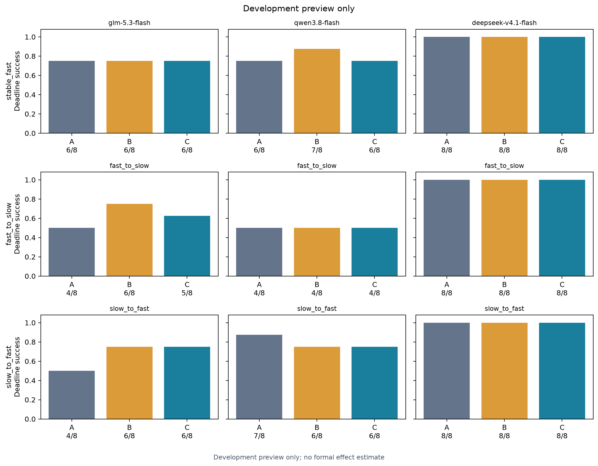
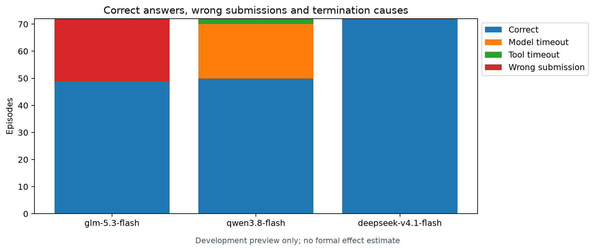
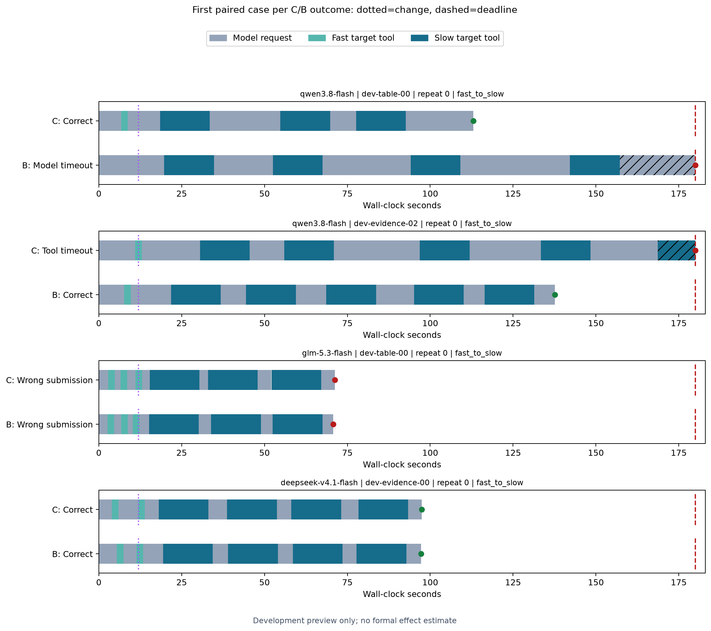

# 三模型工具延迟实验结果

批次：`go-development-20261030T131526625261Z`；配置哈希：`d8361f388fcfee1ad7e90c8061cfd9d3447071b76e3edef9347a46c725cb4b3f`。

这是开发预览，仅作描述，未计算正式效果区间。

完成 216 次，截止前数值与证据同时正确 171 次。

模型：glm-5.3-flash, qwen3.8-flash, deepseek-v4.1-flash。预算 180.0 秒，变化点 12.00 秒，快/慢目标 2/15 秒；并发 `{'global': 6, 'per_model': 2}`。

A/B/C 共同看到时间、校准和历史。A 无额外摘要，B 初始固定均值，C 最近最多三条完整同类工具均值。

| 模型 | 延迟模式 | 条件 | 正确/完成 |
|---|---|---|---:|
| glm-5.3-flash | stable_fast | A | 6/8 |
| glm-5.3-flash | stable_fast | B | 6/8 |
| glm-5.3-flash | stable_fast | C | 6/8 |
| qwen3.8-flash | stable_fast | A | 6/8 |
| qwen3.8-flash | stable_fast | B | 7/8 |
| qwen3.8-flash | stable_fast | C | 6/8 |
| deepseek-v4.1-flash | stable_fast | A | 8/8 |
| deepseek-v4.1-flash | stable_fast | B | 8/8 |
| deepseek-v4.1-flash | stable_fast | C | 8/8 |
| glm-5.3-flash | fast_to_slow | A | 4/8 |
| glm-5.3-flash | fast_to_slow | B | 6/8 |
| glm-5.3-flash | fast_to_slow | C | 5/8 |
| qwen3.8-flash | fast_to_slow | A | 4/8 |
| qwen3.8-flash | fast_to_slow | B | 4/8 |
| qwen3.8-flash | fast_to_slow | C | 4/8 |
| deepseek-v4.1-flash | fast_to_slow | A | 8/8 |
| deepseek-v4.1-flash | fast_to_slow | B | 8/8 |
| deepseek-v4.1-flash | fast_to_slow | C | 8/8 |
| glm-5.3-flash | slow_to_fast | A | 4/8 |
| glm-5.3-flash | slow_to_fast | B | 6/8 |
| glm-5.3-flash | slow_to_fast | C | 6/8 |
| qwen3.8-flash | slow_to_fast | A | 7/8 |
| qwen3.8-flash | slow_to_fast | B | 6/8 |
| qwen3.8-flash | slow_to_fast | C | 6/8 |
| deepseek-v4.1-flash | slow_to_fast | A | 8/8 |
| deepseek-v4.1-flash | slow_to_fast | B | 8/8 |
| deepseek-v4.1-flash | slow_to_fast | C | 8/8 |

## 图

时间线按任务、模型、重复编号排序，在四种 C/B 成败组合中各选第一对；未出现的组合列为缺失，不挑最有利案例。

## 可支持的结论与限制

- 三个模型是固定 Go 别名和同一实验框架的组合，不能外推到所有模型或所有 agent；服务端默认推理设置与具体供应路径并未完全固定。
- 开发实例重复用于可行性校准，不能当作正式测试或独立任务扩容。
- 请求墙钟包含网络、服务、生成和客户端处理；不是纯推理时间。工具阶段按调用开始时刻判定，超时调用为删失。
- 成功率或工具次数改变不足以单独证明策略适应；固定公开前缀探针另行报告，不混入本矩阵。
- 所有失败保留。模型服务异常和未知用量需要结合原始记录单列，不能将未报告消耗当作零。

[描述性计数](counts.json)

[次要指标与轨迹分析](secondary/report.md)
