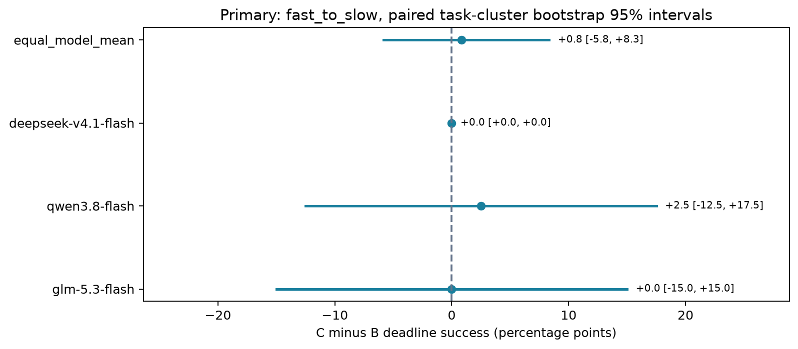
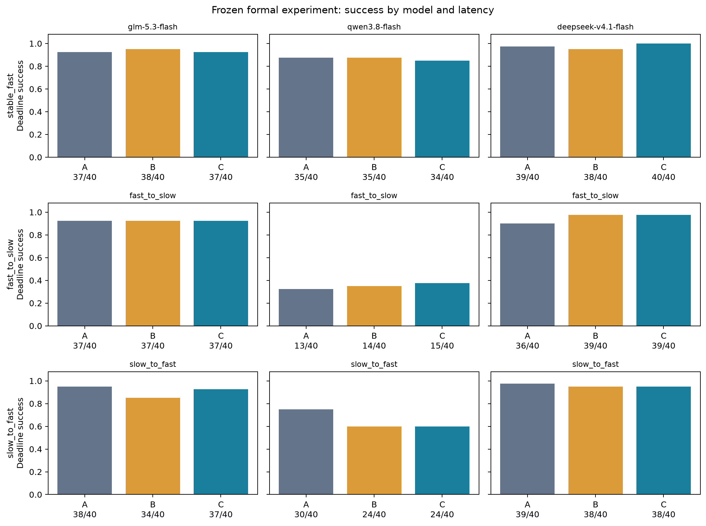
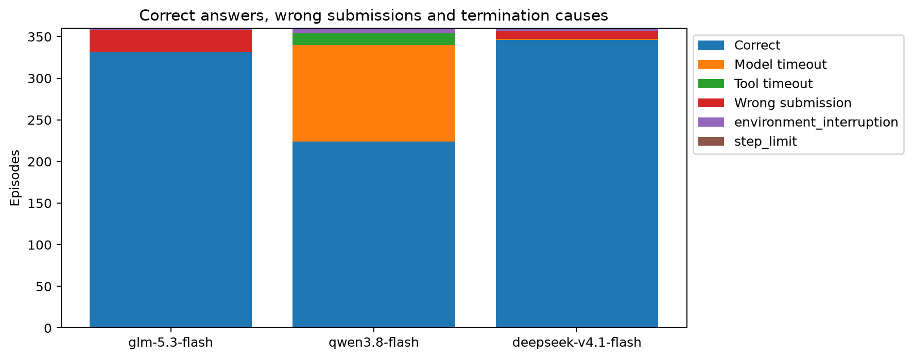
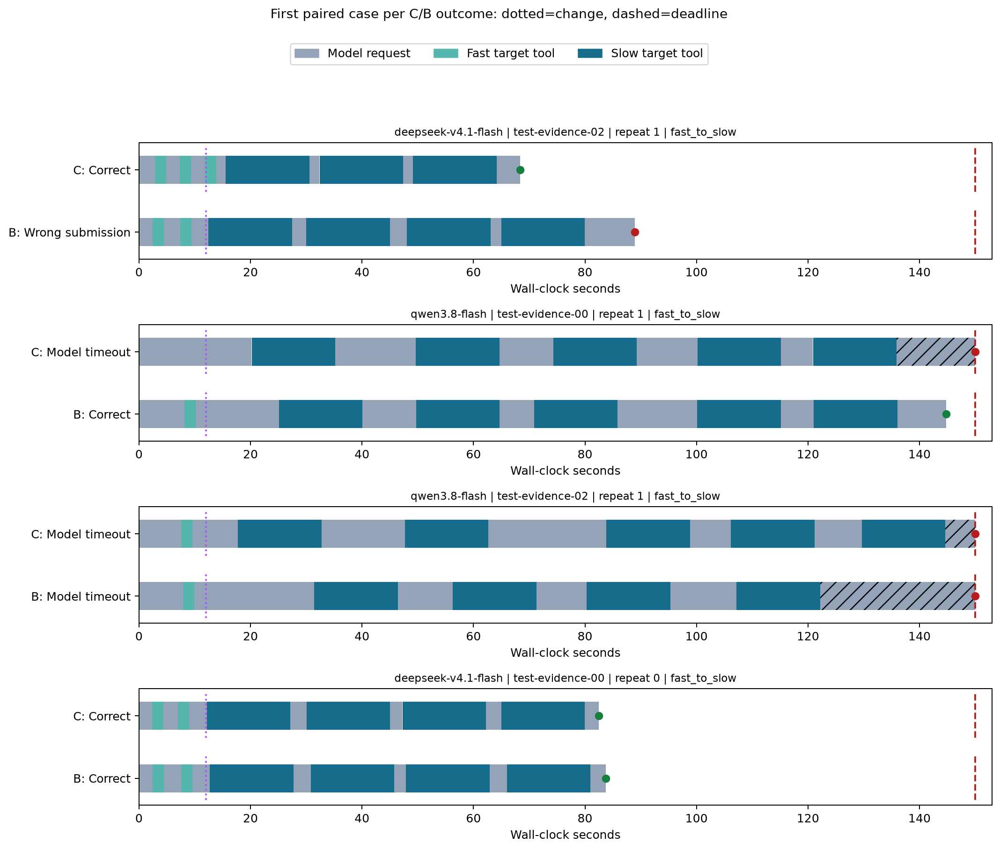

# 三模型工具延迟实验结果

批次：`go-formal-20261031T041031911245Z`；配置哈希：`b95397e0be524bd7149c0580ffe337d6513852f34116e765cd1ee0e638425a39`。

这是完整冻结清单的主实验结果；没有根据测试集结果修改配置或删除失败。运行经历三次宿主休眠，十条环境失败保留，不能称为无中断数据。144次探针已完成，综合解释见[最终报告](../../docs/实验最终报告_20261101.md)。

[中断、敏感性、资源及DeepSeek零宽度区间解释](environment_and_limits.md)

完成 1080 次，截止前数值与证据同时正确 902 次。

模型：glm-5.3-flash, qwen3.8-flash, deepseek-v4.1-flash。预算 150 秒，变化点 12.00 秒，快/慢目标 2/15 秒；并发 `{'global': 6, 'per_model': 2}`。

A/B/C 共同看到时间、校准和历史。A 无额外摘要，B 初始固定均值，C 最近最多三条完整同类工具均值。

| 模型 | 延迟模式 | 条件 | 正确/完成 |
|---|---|---|---:|
| glm-5.3-flash | stable_fast | A | 37/40 |
| glm-5.3-flash | stable_fast | B | 38/40 |
| glm-5.3-flash | stable_fast | C | 37/40 |
| qwen3.8-flash | stable_fast | A | 35/40 |
| qwen3.8-flash | stable_fast | B | 35/40 |
| qwen3.8-flash | stable_fast | C | 34/40 |
| deepseek-v4.1-flash | stable_fast | A | 39/40 |
| deepseek-v4.1-flash | stable_fast | B | 38/40 |
| deepseek-v4.1-flash | stable_fast | C | 40/40 |
| glm-5.3-flash | fast_to_slow | A | 37/40 |
| glm-5.3-flash | fast_to_slow | B | 37/40 |
| glm-5.3-flash | fast_to_slow | C | 37/40 |
| qwen3.8-flash | fast_to_slow | A | 13/40 |
| qwen3.8-flash | fast_to_slow | B | 14/40 |
| qwen3.8-flash | fast_to_slow | C | 15/40 |
| deepseek-v4.1-flash | fast_to_slow | A | 36/40 |
| deepseek-v4.1-flash | fast_to_slow | B | 39/40 |
| deepseek-v4.1-flash | fast_to_slow | C | 39/40 |
| glm-5.3-flash | slow_to_fast | A | 38/40 |
| glm-5.3-flash | slow_to_fast | B | 34/40 |
| glm-5.3-flash | slow_to_fast | C | 37/40 |
| qwen3.8-flash | slow_to_fast | A | 30/40 |
| qwen3.8-flash | slow_to_fast | B | 24/40 |
| qwen3.8-flash | slow_to_fast | C | 24/40 |
| deepseek-v4.1-flash | slow_to_fast | A | 39/40 |
| deepseek-v4.1-flash | slow_to_fast | B | 38/40 |
| deepseek-v4.1-flash | slow_to_fast | C | 38/40 |

## 预先指定的主要比较

fast_to_slow 下，三模型等权 C−B 为 **+0.83 个百分点**，按任务实例聚类、任务族分层的 10,000 次配对 bootstrap 95% 区间为 **[-5.83, +8.33]** 个百分点。

区间包含零，当前数据未给出方向确定的差异证据；这不等于证明两种方法等效。

## 图

时间线按任务、模型、重复编号排序，在四种 C/B 成败组合中各选第一对；未出现的组合列为缺失，不挑最有利案例。

## 可支持的结论与限制

- 三个模型是固定 Go 别名和同一实验框架的组合，不能外推到所有模型或所有 agent；服务端默认推理设置与具体供应路径并未完全固定。
- 完整任务只有 20 个独立测试实例，模板结构相关；重复与条件不是额外独立任务。单模型区间是探索性结果，未做多重检验校正。
- 请求墙钟包含网络、服务、生成和客户端处理；不是纯推理时间。工具阶段按调用开始时刻判定，超时调用为删失。
- 成功率或工具次数改变不足以单独证明策略适应；固定公开前缀探针另行报告，不混入本矩阵。
- 所有失败保留。模型服务异常和未知用量需要结合原始记录单列，不能将未报告消耗当作零。

[统计明细](primary_statistics.json)

[次要指标与轨迹分析](secondary/report.md)
