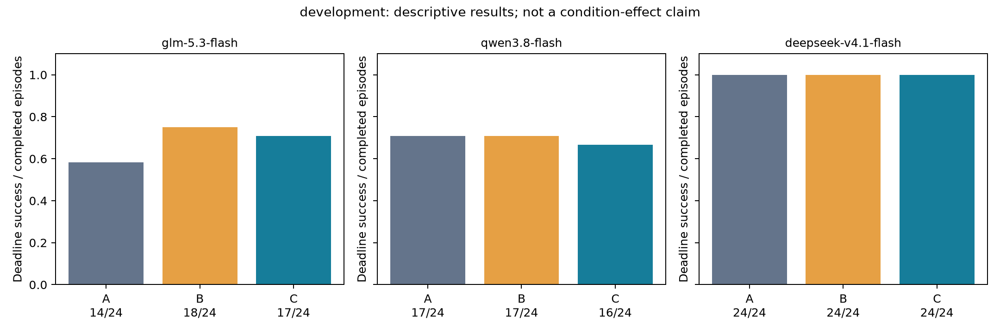
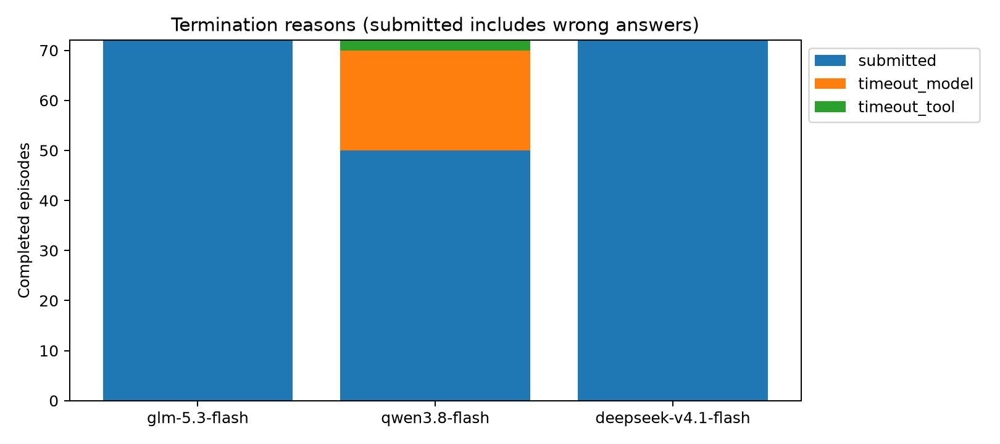
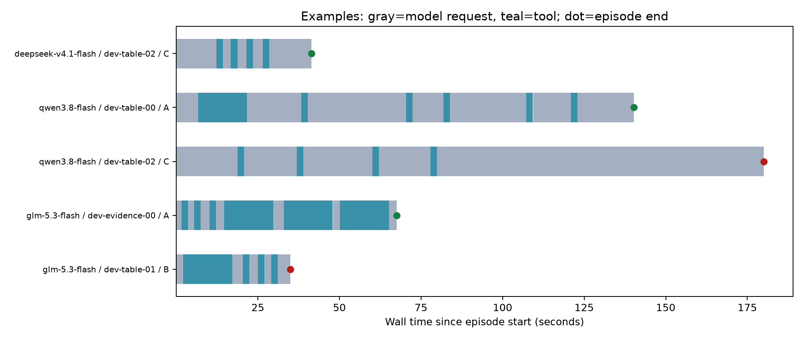

# 三模型实验批次报告

批次：`go-development-20261030T131526625261Z`；阶段：`development`。
计划 216，完成 216，截止前正确 171；未完成 0。

开发/诊断结果用于可行性判断，不能当作冻结后的正式条件效果。服务失败、超时和错误提交均保留。

设置：预算 180.0 秒，变化比例 0.06666666666666667，每模型并发 2，全局最多 6。

计费来源记录：`{'go': 1333, 'unreported': 33}`；已报告套餐额度消耗合计 0.483860。未报告部分不填零。

| 模型 | 任务族 | 模式 | 条件 | 正确/完成 |
|---|---|---|---|---:|
| deepseek-v4.1-flash | evidence | fast_to_slow | A | 4/4 |
| deepseek-v4.1-flash | evidence | fast_to_slow | B | 4/4 |
| deepseek-v4.1-flash | evidence | fast_to_slow | C | 4/4 |
| deepseek-v4.1-flash | evidence | slow_to_fast | A | 4/4 |
| deepseek-v4.1-flash | evidence | slow_to_fast | B | 4/4 |
| deepseek-v4.1-flash | evidence | slow_to_fast | C | 4/4 |
| deepseek-v4.1-flash | evidence | stable_fast | A | 4/4 |
| deepseek-v4.1-flash | evidence | stable_fast | B | 4/4 |
| deepseek-v4.1-flash | evidence | stable_fast | C | 4/4 |
| deepseek-v4.1-flash | table | fast_to_slow | A | 4/4 |
| deepseek-v4.1-flash | table | fast_to_slow | B | 4/4 |
| deepseek-v4.1-flash | table | fast_to_slow | C | 4/4 |
| deepseek-v4.1-flash | table | slow_to_fast | A | 4/4 |
| deepseek-v4.1-flash | table | slow_to_fast | B | 4/4 |
| deepseek-v4.1-flash | table | slow_to_fast | C | 4/4 |
| deepseek-v4.1-flash | table | stable_fast | A | 4/4 |
| deepseek-v4.1-flash | table | stable_fast | B | 4/4 |
| deepseek-v4.1-flash | table | stable_fast | C | 4/4 |
| glm-5.3-flash | evidence | fast_to_slow | A | 3/4 |
| glm-5.3-flash | evidence | fast_to_slow | B | 4/4 |
| glm-5.3-flash | evidence | fast_to_slow | C | 4/4 |
| glm-5.3-flash | evidence | slow_to_fast | A | 3/4 |
| glm-5.3-flash | evidence | slow_to_fast | B | 4/4 |
| glm-5.3-flash | evidence | slow_to_fast | C | 4/4 |
| glm-5.3-flash | evidence | stable_fast | A | 4/4 |
| glm-5.3-flash | evidence | stable_fast | B | 4/4 |
| glm-5.3-flash | evidence | stable_fast | C | 4/4 |
| glm-5.3-flash | table | fast_to_slow | A | 1/4 |
| glm-5.3-flash | table | fast_to_slow | B | 2/4 |
| glm-5.3-flash | table | fast_to_slow | C | 1/4 |
| glm-5.3-flash | table | slow_to_fast | A | 1/4 |
| glm-5.3-flash | table | slow_to_fast | B | 2/4 |
| glm-5.3-flash | table | slow_to_fast | C | 2/4 |
| glm-5.3-flash | table | stable_fast | A | 2/4 |
| glm-5.3-flash | table | stable_fast | B | 2/4 |
| glm-5.3-flash | table | stable_fast | C | 2/4 |
| qwen3.8-flash | evidence | fast_to_slow | A | 3/4 |
| qwen3.8-flash | evidence | fast_to_slow | B | 4/4 |
| qwen3.8-flash | evidence | fast_to_slow | C | 3/4 |
| qwen3.8-flash | evidence | slow_to_fast | A | 4/4 |
| qwen3.8-flash | evidence | slow_to_fast | B | 4/4 |
| qwen3.8-flash | evidence | slow_to_fast | C | 4/4 |
| qwen3.8-flash | evidence | stable_fast | A | 4/4 |
| qwen3.8-flash | evidence | stable_fast | B | 4/4 |
| qwen3.8-flash | evidence | stable_fast | C | 4/4 |
| qwen3.8-flash | table | fast_to_slow | A | 1/4 |
| qwen3.8-flash | table | fast_to_slow | B | 0/4 |
| qwen3.8-flash | table | fast_to_slow | C | 1/4 |
| qwen3.8-flash | table | slow_to_fast | A | 3/4 |
| qwen3.8-flash | table | slow_to_fast | B | 2/4 |
| qwen3.8-flash | table | slow_to_fast | C | 2/4 |
| qwen3.8-flash | table | stable_fast | A | 2/4 |
| qwen3.8-flash | table | stable_fast | B | 3/4 |
| qwen3.8-flash | table | stable_fast | C | 2/4 |

## 准入检查

- `{"model": "glm-5.3-flash", "family": "evidence", "check": "basic_solvability", "n": 12, "success": 12, "pass": true}`
- `{"model": "glm-5.3-flash", "family": "evidence", "profile": "fast_to_slow", "check": "change_opportunity", "n": 12, "exposed": 12, "same_tool_both_phases": 6, "post_shift_valid_action": 12, "success": 11, "pass": true}`
- `{"model": "glm-5.3-flash", "family": "evidence", "profile": "slow_to_fast", "check": "change_opportunity", "n": 12, "exposed": 12, "same_tool_both_phases": 10, "post_shift_valid_action": 12, "success": 11, "pass": true}`
- `{"model": "glm-5.3-flash", "family": "table", "check": "basic_solvability", "n": 12, "success": 6, "pass": true}`
- `{"model": "glm-5.3-flash", "family": "table", "profile": "fast_to_slow", "check": "change_opportunity", "n": 12, "exposed": 12, "same_tool_both_phases": 12, "post_shift_valid_action": 12, "success": 4, "pass": true}`
- `{"model": "glm-5.3-flash", "family": "table", "profile": "slow_to_fast", "check": "change_opportunity", "n": 12, "exposed": 12, "same_tool_both_phases": 12, "post_shift_valid_action": 12, "success": 5, "pass": true}`
- `{"model": "glm-5.3-flash", "check": "primary_outcome_variability", "n": 24, "success": 15, "pass": true}`
- `{"model": "qwen3.8-flash", "family": "evidence", "check": "basic_solvability", "n": 12, "success": 12, "pass": true}`
- `{"model": "qwen3.8-flash", "family": "evidence", "profile": "fast_to_slow", "check": "change_opportunity", "n": 12, "exposed": 12, "same_tool_both_phases": 11, "post_shift_valid_action": 12, "success": 10, "pass": true}`
- `{"model": "qwen3.8-flash", "family": "evidence", "profile": "slow_to_fast", "check": "change_opportunity", "n": 12, "exposed": 12, "same_tool_both_phases": 8, "post_shift_valid_action": 12, "success": 12, "pass": true}`
- `{"model": "qwen3.8-flash", "family": "table", "check": "basic_solvability", "n": 12, "success": 7, "pass": true}`
- `{"model": "qwen3.8-flash", "family": "table", "profile": "fast_to_slow", "check": "change_opportunity", "n": 12, "exposed": 12, "same_tool_both_phases": 4, "post_shift_valid_action": 11, "success": 2, "pass": true}`
- `{"model": "qwen3.8-flash", "family": "table", "profile": "slow_to_fast", "check": "change_opportunity", "n": 12, "exposed": 12, "same_tool_both_phases": 4, "post_shift_valid_action": 11, "success": 7, "pass": true}`
- `{"model": "qwen3.8-flash", "check": "primary_outcome_variability", "n": 24, "success": 12, "pass": true}`
- `{"model": "deepseek-v4.1-flash", "family": "evidence", "check": "basic_solvability", "n": 12, "success": 12, "pass": true}`
- `{"model": "deepseek-v4.1-flash", "family": "evidence", "profile": "fast_to_slow", "check": "change_opportunity", "n": 12, "exposed": 12, "same_tool_both_phases": 11, "post_shift_valid_action": 12, "success": 12, "pass": true}`
- `{"model": "deepseek-v4.1-flash", "family": "evidence", "profile": "slow_to_fast", "check": "change_opportunity", "n": 12, "exposed": 12, "same_tool_both_phases": 12, "post_shift_valid_action": 12, "success": 12, "pass": true}`
- `{"model": "deepseek-v4.1-flash", "family": "table", "check": "basic_solvability", "n": 12, "success": 12, "pass": true}`
- `{"model": "deepseek-v4.1-flash", "family": "table", "profile": "fast_to_slow", "check": "change_opportunity", "n": 12, "exposed": 12, "same_tool_both_phases": 12, "post_shift_valid_action": 12, "success": 12, "pass": true}`
- `{"model": "deepseek-v4.1-flash", "family": "table", "profile": "slow_to_fast", "check": "change_opportunity", "n": 12, "exposed": 12, "same_tool_both_phases": 11, "post_shift_valid_action": 12, "success": 12, "pass": true}`
- `{"model": "deepseek-v4.1-flash", "check": "primary_outcome_variability", "n": 24, "success": 24, "pass": false}`

进入下一阶段：False。此判断不替代正式冻结、模型设置、执行边界和资源检查。

## 图

