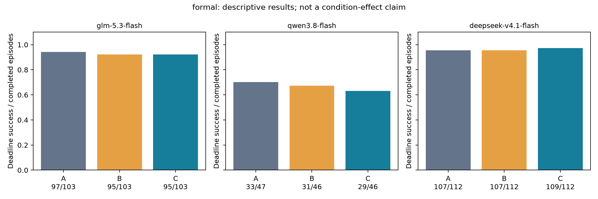
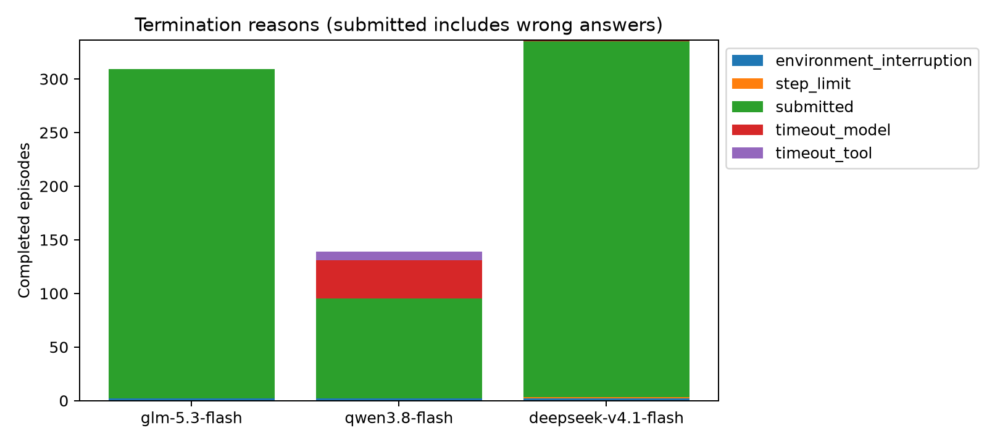
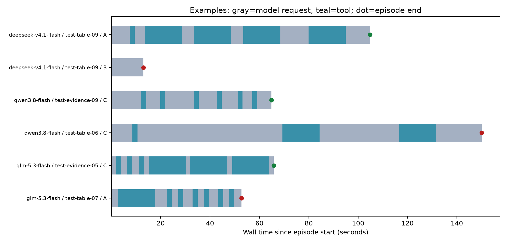

# 三模型实验批次报告

批次：`go-formal-20261031T041031911245Z`；阶段：`formal`。
计划 1080，完成 784，截止前正确 703；未完成 296。

开发/诊断结果用于可行性判断，不能当作冻结后的正式条件效果。服务失败、超时和错误提交均保留。

设置：预算 150 秒，变化比例 0.08，每模型并发 2，全局最多 6。

计费来源记录：`{'go': 4982, 'unreported': 42}`；已报告套餐额度消耗合计 1.373234。未报告部分不填零。

| 模型 | 任务族 | 模式 | 条件 | 正确/完成 |
|---|---|---|---|---:|
| deepseek-v4.1-flash | evidence | fast_to_slow | A | 17/19 |
| deepseek-v4.1-flash | evidence | fast_to_slow | B | 18/19 |
| deepseek-v4.1-flash | evidence | fast_to_slow | C | 18/19 |
| deepseek-v4.1-flash | evidence | slow_to_fast | A | 19/19 |
| deepseek-v4.1-flash | evidence | slow_to_fast | B | 18/19 |
| deepseek-v4.1-flash | evidence | slow_to_fast | C | 18/19 |
| deepseek-v4.1-flash | evidence | stable_fast | A | 17/18 |
| deepseek-v4.1-flash | evidence | stable_fast | B | 16/18 |
| deepseek-v4.1-flash | evidence | stable_fast | C | 18/18 |
| deepseek-v4.1-flash | table | fast_to_slow | A | 17/18 |
| deepseek-v4.1-flash | table | fast_to_slow | B | 18/18 |
| deepseek-v4.1-flash | table | fast_to_slow | C | 18/18 |
| deepseek-v4.1-flash | table | slow_to_fast | A | 19/20 |
| deepseek-v4.1-flash | table | slow_to_fast | B | 19/20 |
| deepseek-v4.1-flash | table | slow_to_fast | C | 19/20 |
| deepseek-v4.1-flash | table | stable_fast | A | 18/18 |
| deepseek-v4.1-flash | table | stable_fast | B | 18/18 |
| deepseek-v4.1-flash | table | stable_fast | C | 18/18 |
| glm-5.3-flash | evidence | fast_to_slow | A | 19/19 |
| glm-5.3-flash | evidence | fast_to_slow | B | 18/19 |
| glm-5.3-flash | evidence | fast_to_slow | C | 19/19 |
| glm-5.3-flash | evidence | slow_to_fast | A | 18/18 |
| glm-5.3-flash | evidence | slow_to_fast | B | 18/18 |
| glm-5.3-flash | evidence | slow_to_fast | C | 18/18 |
| glm-5.3-flash | evidence | stable_fast | A | 16/16 |
| glm-5.3-flash | evidence | stable_fast | B | 16/16 |
| glm-5.3-flash | evidence | stable_fast | C | 16/16 |
| glm-5.3-flash | table | fast_to_slow | A | 15/17 |
| glm-5.3-flash | table | fast_to_slow | B | 15/17 |
| glm-5.3-flash | table | fast_to_slow | C | 14/17 |
| glm-5.3-flash | table | slow_to_fast | A | 14/16 |
| glm-5.3-flash | table | slow_to_fast | B | 12/16 |
| glm-5.3-flash | table | slow_to_fast | C | 13/16 |
| glm-5.3-flash | table | stable_fast | A | 15/17 |
| glm-5.3-flash | table | stable_fast | B | 16/17 |
| glm-5.3-flash | table | stable_fast | C | 15/17 |
| qwen3.8-flash | evidence | fast_to_slow | A | 6/9 |
| qwen3.8-flash | evidence | fast_to_slow | B | 6/9 |
| qwen3.8-flash | evidence | fast_to_slow | C | 6/9 |
| qwen3.8-flash | evidence | slow_to_fast | A | 5/6 |
| qwen3.8-flash | evidence | slow_to_fast | B | 4/5 |
| qwen3.8-flash | evidence | slow_to_fast | C | 3/5 |
| qwen3.8-flash | evidence | stable_fast | A | 9/9 |
| qwen3.8-flash | evidence | stable_fast | B | 9/9 |
| qwen3.8-flash | evidence | stable_fast | C | 9/9 |
| qwen3.8-flash | table | fast_to_slow | A | 1/6 |
| qwen3.8-flash | table | fast_to_slow | B | 2/6 |
| qwen3.8-flash | table | fast_to_slow | C | 3/6 |
| qwen3.8-flash | table | slow_to_fast | A | 6/10 |
| qwen3.8-flash | table | slow_to_fast | B | 5/10 |
| qwen3.8-flash | table | slow_to_fast | C | 5/10 |
| qwen3.8-flash | table | stable_fast | A | 6/7 |
| qwen3.8-flash | table | stable_fast | B | 5/7 |
| qwen3.8-flash | table | stable_fast | C | 3/7 |

## 准入检查

- `{"model": "glm-5.3-flash", "family": "evidence", "check": "basic_solvability", "n": 48, "success": 48, "pass": false}`
- `{"model": "glm-5.3-flash", "family": "table", "check": "basic_solvability", "n": 51, "success": 46, "pass": false}`
- `{"model": "qwen3.8-flash", "family": "evidence", "check": "basic_solvability", "n": 27, "success": 27, "pass": false}`
- `{"model": "qwen3.8-flash", "family": "table", "check": "basic_solvability", "n": 21, "success": 14, "pass": false}`
- `{"model": "deepseek-v4.1-flash", "family": "evidence", "check": "basic_solvability", "n": 54, "success": 51, "pass": false}`
- `{"model": "deepseek-v4.1-flash", "family": "table", "check": "basic_solvability", "n": 54, "success": 54, "pass": false}`

进入下一阶段：False。此判断不替代正式冻结、模型设置、执行边界和资源检查。

## 图

