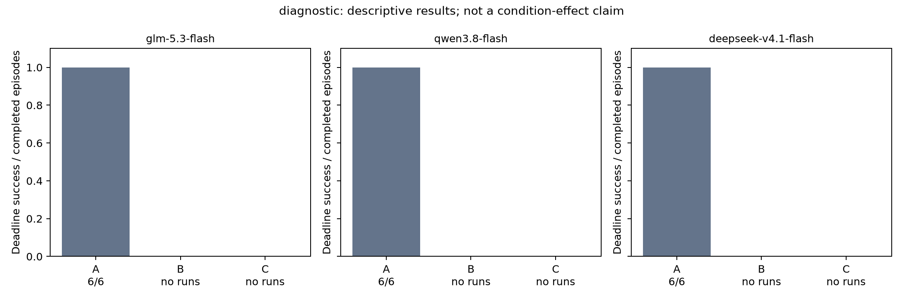
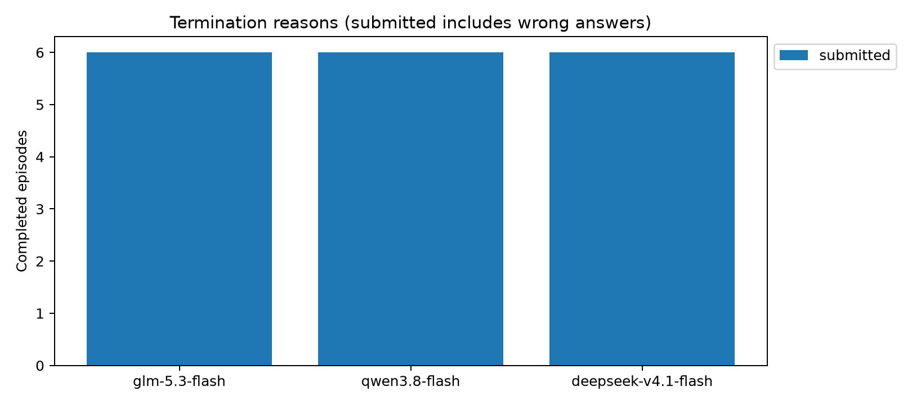
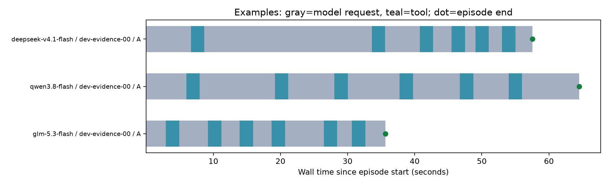

# 三模型实验批次报告

批次：`go-diagnostic-20261030T144203449950Z`；阶段：`diagnostic`。
计划 18，完成 18，截止前正确 18；未完成 0。

开发/诊断结果用于可行性判断，不能当作冻结后的正式条件效果。服务失败、超时和错误提交均保留。

设置：预算 300 秒，变化比例 0.2，每模型并发 2，全局最多 6。

计费来源记录：`{'go': 122}`；已报告套餐额度消耗合计 0.046101。未报告部分不填零。

| 模型 | 任务族 | 模式 | 条件 | 正确/完成 |
|---|---|---|---|---:|
| deepseek-v4.1-flash | evidence | stable_fast | A | 3/3 |
| deepseek-v4.1-flash | table | stable_fast | A | 3/3 |
| glm-5.3-flash | evidence | stable_fast | A | 3/3 |
| glm-5.3-flash | table | stable_fast | A | 3/3 |
| qwen3.8-flash | evidence | stable_fast | A | 3/3 |
| qwen3.8-flash | table | stable_fast | A | 3/3 |

## 准入检查

- `{"model": "glm-5.3-flash", "family": "evidence", "check": "basic_solvability", "n": 3, "success": 3, "pass": true}`
- `{"model": "glm-5.3-flash", "family": "table", "check": "basic_solvability", "n": 3, "success": 3, "pass": true}`
- `{"model": "qwen3.8-flash", "family": "evidence", "check": "basic_solvability", "n": 3, "success": 3, "pass": true}`
- `{"model": "qwen3.8-flash", "family": "table", "check": "basic_solvability", "n": 3, "success": 3, "pass": true}`
- `{"model": "deepseek-v4.1-flash", "family": "evidence", "check": "basic_solvability", "n": 3, "success": 3, "pass": true}`
- `{"model": "deepseek-v4.1-flash", "family": "table", "check": "basic_solvability", "n": 3, "success": 3, "pass": true}`

进入下一阶段：True。此判断不替代正式冻结、模型设置、执行边界和资源检查。

## 图

